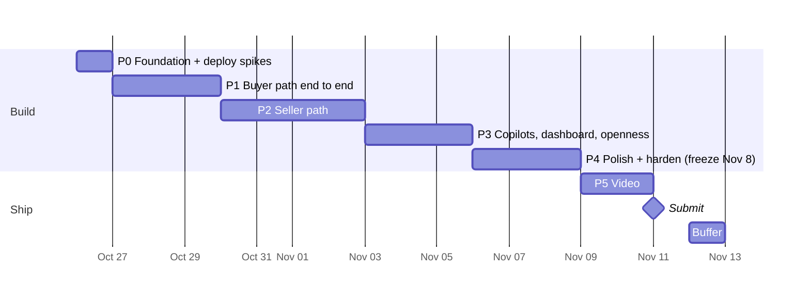

# Counter: Buildout Plan

> Status: **active** · Last updated: 2026-11-04 · Deadline: **Thu Nov 12, 12:00 PM PT** (submit Nov 11)
> What to build: [ARCHITECTURE.md](ARCHITECTURE.md). Why and sandbox evidence: [info-and-planning.md](info-and-planning.md).
> This doc replaces planning doc §10 as the schedule. Tick boxes here as work lands.

---

## 1. Where we are (Oct 26)

| Area | State |
|---|---|
| Idea, architecture, PayPal model | ✅ Locked. Spikes 1–3, 5, 7–10 pass in sandbox |
| Credentials | ✅ Platform Partner App in `.env`. `.gitignore` covers `.env` |
| PH maker onboarded (ISU x2) | ✅ |
| KE, IN, MX makers onboarded | ❌ |
| Code, git repo, LICENSE | ❌ Nothing yet. Planning doc §10 had these done Oct 25, so we start **one day behind** |
| Render deploy | ❌ Blocks spikes 4 (Claude connector → `/api/mcp`) and 11 (webhooks) |

Schedule impact: Phase 0 absorbs the slip today. Phases 1–5 keep the planning doc's dates; Phase 4 (polish) is the buffer if we slip again.

---

## 2. Rules for the build

1. **Never-cut path first:** voice note → listing → agent purchase → maker paid → tracking → release, all real sandbox calls. Every phase ends with this path still working on the Render URL.
2. **Deploy daily.** `main` auto-deploys to Render. Judges and the video use the hosted URL, so it must never be broken overnight.
3. **Money code is boring code.** `lib/paypal` and `lib/policy` get unit tests before any UI calls them. No model output reaches a PayPal request without passing through `lib/policy` (ARCHITECTURE §5.2).
4. **One sandbox script per money flow** in `scripts/` (`e2e-purchase.ts`, `e2e-release.ts`, `e2e-refund.ts`). Run them before every merge that touches `lib/paypal`.
5. **Feature freeze Nov 8 EOD.** After that: bug fixes, copy, and video only.

---

## 3. Timeline

| Phase | Dates | Exit demo (on the Render URL) |
|---|---|---|
| P0 | Oct 26 | Hello-world MCP tool called from Claude; a PayPal webhook lands in `events` |
| P1 | Oct 27–29 | Claude finds a seeded product, checks out, human approves, order reaches `PaidHeld` with fee + `DELAYED` |
| P2 | Oct 30–Nov 2 | Maker records a Spanish voice note + photos on a phone → published listing in < 60s; agent negotiates within floor; maker adds tracking; release-timer releases funds |
| P3 | Nov 3–5 | Seller copilot in Spanish answers and proposes a refund; operator copilot answers fee questions; AG Studio dashboard; ChatGPT buys via MCP |
| P4 | Nov 6–8 | Fresh-clone README works; injection demo beat; empty/error states; seeded demo data final |
| P5 | Nov 9–11 | Public YouTube video < 2:50; Devpost entry submitted |

---

## 4. Phase 0: Foundation (Mon Oct 26)

**Goal:** a deployed skeleton that proves the two untested infrastructure spikes before we build on them.

### 4.1 Repo + app

- [x] `git init`, MIT `LICENSE` · pushed to private repo `xeviert/counter-paypal-agent-commerce` (Oct 31; public at submit)
- [x] Next.js App Router + TS + Tailwind + shadcn/ui; pnpm; Node pinned (`engines` + `.nvmrc`); ESLint; Vitest
- [x] GitHub Actions: typecheck + lint + Vitest on every push
- [x] `lib/env.ts`: Zod-parsed env, fails fast on boot. Adds two vars missing from ARCHITECTURE §10: `APP_BASE_URL` (return/cancel URLs, webhook URL, links returned to agents) and `SESSION_SECRET` (maker sessions, P2). `.env.example` lists names only
- [x] `lib/log.ts`: structured JSON logs. Every PayPal error logs HTTP status, `name` and `debug_id` (PayPal support on Discord asks for `debug_id`)

### 4.2 Database (`lib/db`)

Drizzle schema for every ARCHITECTURE §8 table + `drizzle-zod`. Fix these before the first migration:

- [x] Money as integer minor units + ISO currency column. No floats anywhere
- [x] Status columns are Postgres enums matching ARCHITECTURE §6.5 (added `Canceled`, `Denied`)
- [x] Unique constraints: `orders.paypal_order_id`, `orders.status_token`, `events.paypal_event_id` (PayPal retries webhooks; dedupe on insert)
- [x] `orders` extra fields: `status_token`, `item_amount`, `shipping_amount`, `paypal_fee`, `net_amount`, `shipping_address` (JSONB from PayPal), buyer name + email
- [x] `products` extra fields: `category` (fixed list), `weight_class` (small/medium/large), generated `search` tsvector over EN + native text with a GIN index
- [x] Local Postgres 17 via `docker-compose.yml` (`pnpm db:up`, port 5433); schema tests in `lib/db/schema.test.ts` run against `counter_test` and in CI

### 4.3 Render

- [x] `render.yaml` blueprint: web service + Postgres (+ workflows once confirmed). Doubles as reproducible setup for judges. Validated against Render's schema. **Applied Oct 31** (Blueprint `counter`); web service live, migrations ran in pre-deploy. Build commands call `corepack pnpm` directly: `npm install -g corepack` fails with `EROFS` (Render's `/usr/lib/node_modules` is read-only), and Node 24 ships corepack anyway
- [x] **Paid web instance + paid Postgres from day one** (`0.5c-512mb` web, `0.1c-256mb` Postgres 17, Oregon) (the $50 credits cover it). Free Postgres expires after 30 days, which is before judging ends Dec 15. Free web services sleep after 15 min idle, so agent MCP calls and PayPal webhooks hit cold starts
- [x] Pre-deploy command runs migrations (`node scripts/migrate.ts`, drizzle-orm migrator, no drizzle-kit at runtime); health check at `/api/health` (pings DB, 503 when down); auto-deploy from `main` only after CI passes (`autoDeployTrigger: checksPass`)

### 4.4 Spike 4: MCP endpoint

- [x] `/api/mcp` with one `ping` tool. **Changed Oct 27:** MCP spec 2026-07-28 removed sessions and `Mcp-Session-Id`, and SDK v1 (`@modelcontextprotocol/sdk`) is now maintenance-only. Built on `@modelcontextprotocol/server` v2 `createMcpHandler` with `legacy: "stateless"`: one handler serves 2025-era clients (initialize handshake) and 2026-07-28 clients, no session state. `agentId` = hash of client IP + User-Agent (`lib/mcp/agent.ts`). Tested both eras in-process and against `next start` with MCP Inspector CLI
- [x] Tool call succeeds from a claude.ai custom connector and from the API `mcp_servers` connector (beta `mcp-client-2025-11-20`). ✅ Oct 31 on Render: claude.ai connector "Counter" called `ping` (each tool call asks the user for approval by default). Earlier: **Tunnel attempt Oct 27 failed before reaching us:** claude.ai said "Couldn't reach" a `*.trycloudflare.com` URL three times (support ref `ofid_bac1dd625d2da692`) while the same URL served curl, MCP Inspector and PayPal webhooks, and no request appeared in the tunnel or app logs. Retest on the Render URL; if a tunnel is needed, try ngrok or a named Cloudflare tunnel on our own domain
- [x] API connector: `pnpm spike:mcp https://counter-2cdt.onrender.com` ✅ Oct 31: Claude called `ping` through `mcp_servers` (User-Agent `Claude-User`, protocol `2026-07-28`, ~4.2k input tokens)
- [x] On Render: confirm which header carries the real client IP. ✅ Oct 31: Render is behind Cloudflare. `X-Forwarded-For` = `<client>, <Cloudflare edge>`, so the old rightmost-hop rule keyed every caller to a shared edge IP. `agentFromRequest` now uses `True-Client-IP`, else the second-to-last hop (`lib/mcp/agent.test.ts`). The `mcp request` log line keeps `ip`, `agentId`, raw `forwardedFor` and `trueClientIp` for debugging during judging
- [x] ~~Connect ChatGPT developer mode too~~ **Skipped Oct 31, cut Nov 1** (user decision; §7.7, cut item #2)

### 4.5 Spike 11: webhooks

- [x] Create the webhook on the Platform app subscribed to every ARCHITECTURE §4.6 event; save its id as `PAYPAL_WEBHOOK_ID`. `pnpm paypal:webhook <public URL>` creates or repoints it (sandbox id `4XM06760VD720062T`, repointed to `https://counter-2cdt.onrender.com/api/webhooks/paypal` Oct 31; `PAYPAL_WEBHOOK_ID` set on Render)
- [x] `/api/webhooks/paypal`: read body as text → insert into `events` (dedupe on PayPal event `id`) → verify → mark verified → process
- [x] Verification call: build the `verify-webhook-signature` body as a string with the raw payload spliced in as `webhook_event`. Re-serialized JSON can fail verification. Headers to forward: `paypal-transmission-id`, `paypal-transmission-time`, `paypal-transmission-sig`, `paypal-cert-url`, `paypal-auth-algo`
- [x] Test with a **real** sandbox order (create → approve → capture). Simulator events can't be signature-verified. `pnpm spike:webhooks`: PH maker payee, $0.50 fee, `DELAYED`, $2 partial refund with assertion, release. **All 5 deliveries passed signature verification** (Oct 27)
- [x] Record which events actually arrive for payee-routed captures and for a referenced-payout release. Arrived within ~30s, subscribed with `*`: `CHECKOUT.ORDER.APPROVED`, `PAYMENT.CAPTURE.COMPLETED`, `CHECKOUT.ORDER.COMPLETED`, `PAYMENT.CAPTURE.REFUNDED`, `PAYMENT.REFERENCED-PAYOUT-ITEM.COMPLETED` (resource `reference_id` = capture id). The payout events are missing from PayPal's `webhooks-event-types` list but PayPal accepts them in an explicit subscription. No poll fallback needed
- [x] Re-confirm the release event arrives under the explicit list (not just `*`) on the next `e2e-release.ts` run (§6.3 checklist). ✅ Nov 3: `PAYMENT.REFERENCED-PAYOUT-ITEM.COMPLETED` for capture `0UR37491K86413925` in the deployed `events`
- [x] Save real payloads to `test/fixtures/webhooks/` for P1 handler tests

### 4.6 Render Workflows check

- [x] Confirm TypeScript SDK: `@renderinc/sdk` 1.4.0 (`task()` from `@renderinc/sdk/workflows`, `ctx.run` for chaining, `createWorkflowsClient().runTask/startTask` to trigger). No-op `ping` + chained `pingTwice` in `workflows/index.ts`, run on the local task server (Oct 27): ping 374ms, pingTwice ~1s, triggered from app code. Workflow service added to `render.yaml` (schema-valid)
- [x] Deploy the no-op workflow and time a cold run on Render (local runs say nothing about spin-up; the 60s listing budget depends on it). ✅ Oct 31 (`pnpm spike:workflows counter-workflows`): first run enqueued → completed in 0.5s server-side, `ping` 1–2s and `pingTwice` 1.5–2.6s end to end from a laptop. Workflow overhead is negligible against the 60s budget, so §6.2 can run the Claude call inside the workflow. The SDK's `runTask` hung (>5 min, events stream never returned); use `startTask` + poll `getTaskRun` (`paused` = parent waiting on subtasks)
- **Limits that change the plan:** a task run can last at most **24h** (`timeoutSeconds` 30–86400), and there's no sleep, delay or schedule ("Workflows do not yet natively support scheduling task runs"). A 14-day release timer can't live in a workflow. **Decision:** releases and the 3h checkout expiry run from a **Render cron job** that polls `release_due_at` / `expires_at` every minute (see §6.3). Workflows keep the listing pipeline (retries, separate compute, minutes-long work)
- **Windows:** `render workflows dev` doesn't work natively (CLI hard-codes `/tmp` for a Unix socket; Node on Windows treats socket paths as named pipes, so the SDK hangs). Use `scripts/workflows-check.sh` in a `node:24.22.1-bookworm` container (command in the script header) or WSL

**Gates (decide today):**

| If this fails | Fallback |
|---|---|
| Claude connector can't reach `/api/mcp` | Demo buyer agent = our own script using `@anthropic-ai/sdk` + MCP client SDK against `/api/mcp`. Still agent-driven, less "any client" |
| Webhooks don't arrive | Return URL captures; a poll job checks `GET /v2/payments/captures/{id}` for `PENDING`/refund states |
| Webhooks arrive but verification fails | Treat payload as a hint only: re-fetch the order/capture by id from PayPal and act on that response |
| No TS Workflows SDK (✅ SDK exists; but see the 24h limit in §4.6) | Render cron job polling `release_due_at` and a queue table for listing jobs. Lose Render sponsor angle only (AG Grid is the target anyway) |

---

## 5. Phase 1: Buyer path end to end (Oct 27–29)

**Goal:** an agent buys a real product from a seeded maker and PayPal holds the money.

### 5.1 Pricing rules (decide first, Oct 27 morning)

| Rule | Decision |
|---|---|
| Charge currency | **USD only in P1.** Makers list in USD. EUR for PH/MX (ARCHITECTURE §4.5) only if P3 has time |
| Local prices | Reference only, labeled "approx.", from a static rate table in `lib/policy/fx.ts`. Upgrade: PayPal exchange-rate quotes (`pricing/exchange-currency/read` is granted) |
| Shipping | Flat table in `lib/policy/shipping.ts`: maker country × buyer region (domestic, North America, EU, rest of world) × `weight_class` → USD. Seed sets weight class; listing builder estimates it in P2 |
| Platform fee base | `PLATFORM_FEE_BPS` on `item_total` only, not shipping. Round half-up to the cent |
| Order amount | `item_total + shipping`, both read from DB. Never from agent input |

### 5.2 Shared schemas (`lib/schemas`)

- [x] `listing.ts`: title, description, materials, dimensions, care, provenance story, category, weight class; EN + native. `seed.ts` uses it now; the listing builder outputs it in P2, so seeded and generated products share one shape
- [x] `mcp.ts`: input and output schemas for every MCP tool
- [x] `paypal.ts`: Zod for every PayPal response we read
- [x] `common.ts`: shared enums (DB `pgEnum`s read them), country/currency/status-token formats, cents ↔ decimal string

Decided (Oct 27):
- `listingContent` (stored in `products.listing`): `language`, `en`, `native`, `dimensions`. `listingDraft` adds `category` + `weightClass`, which live in columns only. Localized: `title` (≤127, PayPal `items[].name` cap), `description`, `materials`, `care`, `provenance`. Shared: `dimensions` in cm
- `native` required unless `language` is `en`. Languages: `en`, `es`, `fil`, `sw`, `hi`
- MCP money is `{ currency, value: "12.50" }`; local reference adds `approx: true`. MCP takes `buyerCountry` (required on `create_checkout`), never a currency
- Agents see raw `OrderStatus` plus a `nextStep` sentence. `quantity` 1–10; `search_products` `limit` ≤ 20, no cursor
- PayPal schemas parse money to cents at the boundary; `paypalRequest` takes an optional `schema`. `create_checkout(offerId)` input lands with negotiation in P2

### 5.3 PayPal core (`lib/paypal`)

- [x] Token: client-credentials cache, refresh at 8h or on 401 (in `client.ts` since P0). Added: one shared fetch for concurrent callers, 20s timeout, one retry on network error/5xx for GETs and calls with `PayPal-Request-Id` only, optional Zod `schema`
- [x] `assertion.ts`: `PayPal-Auth-Assertion` builder; `payer_id` always from DB (takes the seller row, throws if not onboarded)
- [x] `orders.ts` **create** (`PayPal-Request-Id: create:{orderId}`):
  - `intent: CAPTURE`; `purchase_units[0]`: `reference_id` + `custom_id` = our order id, `payee.merchant_id`, `items[]` (`category: PHYSICAL_GOODS`), `amount.breakdown` (`item_total`, `shipping`)
  - `payment_instruction`: `platform_fees`, `disbursement_mode: DELAYED`
  - `payment_source.paypal.experience_context`: `return_url`, `cancel_url`, `user_action: PAY_NOW`, `shipping_preference: GET_FROM_FILE`, `brand_name: Counter`
  - Approval link = `links[]` entry with `rel: payer-action`
- [x] `orders.ts` **capture** (`PayPal-Request-Id: capture:{orderId}`, `Prefer: return=representation`):
  - `422 ORDER_ALREADY_CAPTURED` → `GET` the order and treat as success (return URL and `CHECKOUT.ORDER.APPROVED` can race)
  - `422 INSTRUMENT_DECLINED` → send the buyer back to the `payer-action` link
  - Store: `capture_id`, capture `status` (+ `status_details.reason` if `PENDING`), `seller_receivable_breakdown` (`paypal_fee`, `platform_fees`, `net_amount`), `purchase_units[0].shipping` (name + address), `payer` (name, email)
- [x] `referrals.ts`: partner-referrals + merchant-integrations lookup
- [x] `webhooks.ts`: verification from P0 + `parseWebhookResource` (capture events → `capture`, `CHECKOUT.ORDER.APPROVED` → `order`)
- [x] Decided (Oct 27): `lib/paypal` takes priced cents + `merchantId` and never reads the DB or prices anything. Payee errors (`PAYEE_NOT_CONSENTED`, `PAYEE_ACCOUNT_*`) → `SellerNotReceivableError` (→ MCP `SELLER_NOT_RECEIVABLE`). Capture returns `captured` or `payer_action`; the buyer goes back to the new `orders.approval_url` column (migration `0001`), which `get_order_status` also returns. Ship-to region check before capture (ARCHITECTURE §4.3)
- [ ] `scripts/onboard.ts <country>`: create referral → print `action_url` → poll merchant-integrations → print `merchant_id`, `payments_receivable`, `primary_email_confirmed`, granted scopes. Onboarding UI waits for P2. Built + unit-tested Oct 27; not yet run against the sandbox (first real run = MX in §5.7). `--merchant-id` imports an already-linked maker (PH)
- [ ] `scripts/e2e-purchase.ts`: create → print approval link → capture → assert `DELAYED`, fee, and that DB amounts match `seller_receivable_breakdown`

### 5.4 Policy + state (`lib/policy`, `lib/db/orders.ts`)

- [x] `currency.ts` (ARCHITECTURE §4.5), `fx.ts`, `shipping.ts`, `fees.ts` (integer cents), plus `quote.ts`: `quoteOrder()` is the one place order amounts are computed (item, shipping, total, fee); `openCheckout` stores its output
- [x] `stock.ts`: reserve with a single conditional update (`UPDATE ... SET reserved = reserved + n WHERE stock - reserved >= n`) so concurrent checkouts can't oversell. `releaseStock` / `commitStock` throw if the units aren't reserved
- [x] `lib/db/orders.ts` state machine: one `transition()` that locks the row, validates the edge (`lib/policy/lifecycle.ts`), applies the stock effect and writes an `events` row in one transaction. `openCheckout()` reserves + inserts `CheckoutCreated` + logs `order.created`
- [x] Expiry sweep: `expireStaleCheckouts()` (`CheckoutCreated` past `expires_at` → `Expired`, release stock, `FOR UPDATE SKIP LOCKED`). `scripts/cron-sweep.ts` (`pnpm cron:sweep`) + `counter-sweep` cron in `render.yaml` (every 15 min since Oct 31 to save run time; back to `* * * * *` in P2). P2 adds releases to the same job
- [x] Unit tests: every allowed and forbidden transition; fee rounding; fee excludes shipping; shipping lookup per region; INR/KES rejected; IN + EUR rejected; stock reservation under concurrency (`lib/policy/*.test.ts`, `lib/db/orders.test.ts`). Pass against local Postgres (Oct 30, 472/472 suite-wide)

Decided (Oct 30):
- Shipping is flat **per order**, not per unit (matches `shippingQuote` in `lib/schemas/mcp.ts`). Table values are placeholders until we check real carrier rates
- `PolicyError(code)` carries the MCP error code (`UNSUPPORTED_COUNTRY`, `INVALID_QUANTITY`, `OUT_OF_STOCK`) so 5.5 maps it straight to `isError`. Buyer country must be a real ISO region and not sanctioned (CU, IR, KP, SY, RU)
- Edges beyond the §6.5 diagram: `Approved → Canceled` (ship-to region mismatch), `Approved → Denied` (capture returns `DECLINED`), `PaidHeld → Released` (buyer confirms before tracking), `Disputed → PaidHeld | Shipped` (resolved for maker, timer resumes)
- Stock follows status: reserved (`CheckoutCreated`, `Approved`, `PaidPending`) → committed on `PaidHeld` (stock − n) or released on `Expired`/`Canceled`/`Denied`. Refunds don't restock
- `transition()` is a no-op when the order is already in the target state (duplicate webhooks), and takes an optional `from` guard so racing triggers skip quietly instead of throwing
- The sweep leaves `Approved` alone (a capture may be in flight). 5.6 must move an order to `Approved` (locked, `from: CheckoutCreated`) **before** calling capture, so the sweep can't expire an order we're capturing
- New `cron` event source (migration `0002`). The sweep reads `DATABASE_URL` only; P2 release adds the PayPal vars (move shared env to an `envVarGroup` then)

### 5.5 MCP tools

- [x] `search_products`: Postgres full-text (`websearch_to_tsquery`) over EN + native text; filters: category, max price, buyer country. Returns summaries with item price, shipping to buyer, approx local price
- [x] `get_product`: full listing, photo URLs, provenance, shipping to buyer country, USD price + approx local reference
- [x] `create_checkout(productId, quantity, buyerCountry)`: check maker `payments_receivable`, reserve stock, create PayPal order → return approval link, `/o/{statusToken}` URL, total breakdown, expiry time
- [x] `get_order_status(statusToken)`
- [x] Tool descriptions written for agents: when to call each tool, that the human must approve on PayPal, that quoted totals are final
- [x] Each tool returns `structuredContent` + a short text summary. Errors return `isError` with stable codes: `OUT_OF_STOCK`, `SELLER_NOT_RECEIVABLE`, `UNSUPPORTED_COUNTRY` (`OFFER_EXPIRED` in P2)
- [x] Every call logged to `events` with `agentId`
- [x] Rate limit per `agentId` and per IP (in-memory; single instance)
- [x] DB-backed tests (`lib/shop/*.test.ts`, the DB block in `lib/mcp/server.test.ts`) pass against local Postgres (Oct 30)

Decided (Oct 30):
- Logic lives in `lib/shop/` (`catalog.ts`, `checkout.ts`, `order-status.ts`, `urls.ts`) so ACP (§7.6) and the `/o` page reuse it; `lib/mcp/tools.ts` only adapts. `buildMcpHandler({ db, limiter })` lets tests inject both
- Agents only see live, unrestricted products. Draft/review → `PRODUCT_NOT_FOUND`; paused/restricted → `PRODUCT_UNAVAILABLE`. Checkout also needs `merchant_id`, `payments_receivable` and `consent_status = granted`
- PayPal create fails after stock is reserved → order `Canceled` (frees stock, payload `paypal_create_failed`); payee errors → `SELLER_NOT_RECEIVABLE`, anything else → `PAYMENT_PROVIDER_ERROR`
- New code `INTERNAL_ERROR`: the SDK would otherwise send raw `error.message` to agents
- `events` row per call: `type: mcp.<tool>`, `actor: agentId`, payload `{ args, outcome, code?, count?, ms, userAgent }`; `statusToken` redacted. Product/order ids set only on success (FKs). Rate-limited calls are a log line only
- Limits: 120/min per `agentId`, 600/min per IP, `create_checkout` 20 per 10 min per `agentId`. claude.ai connector traffic comes from Anthropic's IPs, so many users can share one `agentId`; revisit on Render once we see real headers (§4.4)
- `ping` stays for connector debugging. Links point at `/p/{slug}`, `/o/{token}`, `/api/photos/{id}`, which land in 5.6/5.7

### 5.6 Pages + webhook handlers

- [x] `/checkout/return`: idempotent capture → redirect to `/o/[statusToken]`
- [x] `/checkout/cancel`: release stock, show "you weren't charged"
- [x] `/o/[statusToken]`: random 128-bit token, never the DB id. "I received it" releases funds in P2, so a guessable URL would let anyone trigger a release. Shows status, item, and ship-to city + country only (no full address)
- [x] `/p/[slug]`: plain product page (JSON-LD in P3)
- [x] Handlers for `CHECKOUT.ORDER.APPROVED`, `PAYMENT.CAPTURE.COMPLETED`, `PAYMENT.CAPTURE.PENDING`, `PAYMENT.CAPTURE.DENIED`
- [x] Handler tests replay P0 fixtures: duplicate delivery, `COMPLETED` arriving before the return URL fires, `PENDING` then `COMPLETED` (`lib/shop/payment.test.ts`). Pass locally (Oct 30). First run caught a bug: an `APPROVED` delivery already showing `COMPLETED` on a `CheckoutCreated` order was skipped as stale; both triggers now step through `Approved` via `recordCompletedOrder()`

Decided (Oct 30):
- One flow for both capture triggers (`lib/shop/payment.ts`): `settleApprovedOrder()` GETs the PayPal order → already `COMPLETED` → record it, no second capture; ship-to outside the quoted region → `Canceled` (no capture); else `Approved` (locked, `from: CheckoutCreated`, so the sweep can't race it) → capture → `recordCapture()`
- `recordCapture()` maps capture status → `PaidHeld` (`COMPLETED`, and refund states since resources show delivery-time state), `PaidPending`, `Denied`. Stale or out-of-order deliveries are skipped, never thrown, so PayPal doesn't retry them forever. Buyer name, email and address are saved whenever an order resource offers them. Amount or fee mismatches vs the quote are logged, not blocking. A capture landing on an order we closed unpaid logs an error (needs a refund by hand)
- Capture events find our order via `supplementary_data.related_ids.order_id` → `orders.paypal_order_id` (not `custom_id`). Unknown orders (spike runs) are acknowledged with 200
- Return URL: payer-action issues (`INSTRUMENT_DECLINED` …) redirect straight back to PayPal's approval link; a PayPal outage still lands on `/o` (order stays `Approved`, link shown, the webhook retries). Cancel only cancels a `CheckoutCreated` order
- `Approved` orders whose buyer never finishes keep their stock reserved (the sweep skips them). Surface them in the `/ops` stale view (P3)
- The inbox links each processed webhook `events` row to our order (`order_id`). Handlers live in `lib/shop/webhook-handlers.ts`; the route wires them in, so `lib/paypal` doesn't import `lib/shop`
- `/o` sets `referrer: no-referrer` and `noindex` (the token controls the order). Pages read the DB inside `<Suspense>` (Cache Components): `/o` and `/p` build as partial prerenders. `notFound()` there streams the 404 UI with HTTP 200, which is fine for these pages

### 5.7 Seed data

- [x] `scripts/onboard.ts` for **KE, MX** (user approves each in the browser; **IN dropped Oct 31**, no persona) → store `merchant_id`s. Steps: `pnpm seed` → `pnpm onboard --seller <id>` per maker (ids printed by seed; PH: `--merchant-id MPMWEFYQWQYUA`) → `pnpm seed` again to publish. Oct 31 on local DB: all three linked, receivable, email confirmed, 9 scopes each: MX `2Y6DQGZ4HV2DE`, PH `MPMWEFYQWQYUA` (imported), KE `RWTZ65SJSKYB4` → 26 products live. Another DB (Render) picks them up with `pnpm onboard --seller <id>`, no browser (lookup by `tracking_id`).
- [x] `scripts/seed.ts` + `seed/catalog.ts`: 3 personas (Lucía Hernández, Teotitlán del Valle MX, 14 rugs/textiles (4 added Oct 31: sarape, hallway runner, dye sampler, coin purse); Rosa Villanueva, Manila PH, 8 baskets; Wanjiru Kamau, Nairobi KE, 8 beadwork pieces; IN dropped) through `lib/schemas/listing.ts`, with category, weight class, stock, floor at 85%. Run Oct 31 on local DB: 30 live
- [ ] Real photos we own or licensed in `seed/photos/<slug>/` (`seed/photos/README.md`); none yet
- [x] Photo storage + `/api/photos/[id]` route built now (§10 #2); seed photos go through the same resize + EXIF strip as P2 uploads (`lib/photos.ts`, sharp)
- [x] Re-check reporting + disputes with assertion (ARCHITECTURE §11 #3): ✅ Oct 30, transactions, balances and disputes list all 200 for the PH maker (`pnpm check:assertion`)

Decided (Oct 30):
- Seed makers have fixed UUIDs, which are also their PayPal `tracking_id`s, so seeding and onboarding can run in either order and re-runs never duplicate. Products publish (`live`) only when the maker is receivable, email-confirmed and consented; otherwise `draft`. Re-seeding updates text and prices, never stock, reservations or PayPal fields
- Personas are fictional. Spanish, Filipino and Swahili text was written by Claude and needs a native speaker's pass before the video (§6.1 language note)
- Photo pipeline: sharp `rotate()` (applies EXIF orientation) → fit inside 1280px, no upscaling → WebP q80, no metadata written (EXIF, GPS, XMP gone; tested). 5 MB input cap. `/api/photos/[id]` serves by random UUID with `immutable` caching; photos never change in place

**Exit:** Claude (connector or fallback script) buys from the MX maker. Order reaches `PaidHeld`. DB item, shipping, Counter fee, PayPal fee and net amounts match the capture response. Buyer address stored. Stock decremented. The `PAYMENT.CAPTURE.COMPLETED` webhook is deduped against the return-URL capture.

---

## 6. Phase 2: Seller path (Oct 30–Nov 2)

**Goal:** the maker side of the never-cut path, on a phone.

Four days, three tracks. Build in never-cut order so a slip only costs negotiation:

| Day | Work | Why this order |
|---|---|---|
| Oct 30 | §6.3 post-sale money | Backend only, builds directly on P1, never-cut |
| Oct 31–Nov 1 | §6.1 maker app + §6.2 listing pipeline | Never-cut; needs real-phone testing time |
| Nov 1 (2h) | AG Studio spike (§7.3) | Surfaces sponsor-integration unknowns before P3 |
| Nov 2 | §6.4 negotiation | Cut item #7; fixed-price checkout works without it |

### 6.1 Maker app (`/s/*`)

**Auth + scoping**
- [x] Auth per §10 #1: email + password sign-up/sign-in (`lib/auth/`), plus one-tap demo makers on `/s/login` when `DEMO_LOGIN=true` (makers with no email). Sign-up 5 per 10 min and sign-in 10/min per IP
- [x] `requireSeller()` (`lib/auth/seller.ts`): every `/s/*` query and server action takes `seller_id` from the session, never from input. `proxy.ts` only redirects cookie-less requests. Test: maker A gets not-found for maker B's order, draft, tracking and refund (`lib/shop/maker.test.ts`)

**Onboarding**
- [x] Sign-up (name, email, password, country, language) → `/s/onboarding` → Connect PayPal (`referrals.ts`) → `/s/onboarding/return`
- [x] Return URL params are ignored; `syncOnboarding()` (`lib/shop/onboarding.ts`, shared with `scripts/onboard.ts`) asks merchant-integrations by `tracking_id`. "Check again" button for when PayPal is slow
- [x] Publishing blocked until receivable, email confirmed and consent granted (`lib/policy/seller.ts` `publishBlockers`, also used by seed and checkout); each missing step explained in the maker's language. Listings published before that stay `draft` and get a Publish button once the maker can be paid
- [ ] Run once against the sandbox with a fresh maker through `/s/onboarding` (needs a new sandbox business account)

**Language**
- [x] Whole maker UI localized: `en`, `es`, `fil`, `sw`. Own typed catalogs in `lib/i18n/messages/` instead of `next-intl`: no locale routing needed, the locale comes from `sellers.language`, and a missing key fails typecheck and `lib/i18n/i18n.test.ts`. Notifications store a kind + params and render from the same catalogs. Claude drafted es/fil/sw; **needs a native speaker's pass**

**Capture**
- [x] Photos: up to 4, one per server action; resized on the phone to 1280px **JPEG** (iOS Safari can't encode WebP; the canvas also turns HEIC into JPEG and drops EXIF), then `processPhoto` makes WebP and strips metadata again. Server accepts JPEG/PNG/WebP only. Server action body limit raised to 6 MB. The first upload creates the draft
- [x] Voice: `MediaRecorder` audio always uploaded (`voice_notes`, mime as recorded), live Web Speech transcript where available (`es-MX`, `fil-PH`, `sw-KE`), editable transcript box, 3 min cap (`components/maker/use-voice.ts`)
- [ ] Real-phone test matrix: iOS Safari + Android Chrome × es/fil/sw, in browser and installed-PWA mode. Check whether MediaRecorder and Web Speech can share the mic on iOS. Then decide STT (§10 #3)

**Review + publish**
- [x] Review screen: native + EN text, category, size class, dimensions, list price (with approx local), floor, stock → publish. One floor field instead of floor + max discount (same limit); `max_discount_bps` is derived. Floor defaults to 85% of list until edited. Photo reorder lives on the capture screen. Until §6.2 lands the maker writes the text; their transcript starts the native description
- [x] Draft progress by stage (`stage-progress.tsx`, polls `drafts.stage`); §6.2 drives the stages
- [x] `/s/listings`: drafts to finish, products with status, stock edit (never below reserved), pause / show again

**Orders**
- [x] Orders list + detail (paid orders only): buyer name + email, full shipping address, item, fees, refunds, net (estimate before capture), release status/ETA
- [x] Add tracking: carriers per maker country from PayPal's carrier list (checked Oct 31: MX Correos/Estafeta/Paquetexpress/Redpack, PH PHLPost/J&T/2GO/JAM/SPX, KE Posta Kenya, plus DHL/FedEx/UPS) or `OTHER` + name. v2 `track` with assertion, `track:{orderId}`; `PaidHeld → Shipped` sets `release_due_at` (`lib/shop/fulfillment.ts`). Not yet run against the sandbox
- [x] Refund (full or partial, with reason) behind a confirm dialog. A pending `refunds` row is written before the PayPal call so a retry replays `refund:{orderId}:{n}`; a 4xx marks it failed. Full refund → `Refunded`. Refused after release. Same server action for the P3 copilot. Not yet run against the sandbox
- [x] `notifications` + `/s/inbox` with unread badge. `recordCapture` writes paid / capture pending; the other kinds have strings and wait for the §6.3 webhooks
- [x] PWA manifest (`start_url: /s`) + icons; every screen built at 390px

### 6.2 Listing pipeline

- [x] `lib/ai/listing.ts`: `claude-sonnet-5-5`, photos as base64 WebP + transcript in a `<maker_transcript>` block, one streamed call with structured output (`betaZodOutputFormat(listingBuilderOutput)`), adaptive thinking at `low` effort, `fallbacks: "default"`. The SDK throws when it can't parse structured output (a refusal has no JSON), so the stop reason is read from the stream events first. Refused or invalid → draft `failed` → "write it yourself" + Try again
- [x] `lib/ai/client.ts`: one Anthropic client (reads `process.env`, not `getEnv`, so the workflow service can use it). `ai.call` event per call: role, model, ms, stop reason, usage (input, output, cache read/write). `AI_DAILY_CALL_CAP` (default 300) is a count of today's `ai.call` rows; over cap the draft goes `failed`/`capped` and the maker app says drafting is paused
- [x] Per-maker cap: 20 listing calls per UTC day, retries included (`MAKER_DAILY_DRAFTS`). Workflow task retries at most 2 times
- [x] Output: category, size class, native + EN text, dimensions (only if said), `spokenPriceUsd`, price guidance, restricted flag. Flat nullable schema for the model (`listingBuilderOutput`); `toDraftResult` re-validates against the stored `draftResult` rules (refine, lengths). Flagged drafts publish to `review`
- [x] Price guidance grounded in the spoken price and live catalog min/median/max per category (`categoryPrices`); spoken price pre-fills the list price on review (floor follows at 85%), guidance shown as a suggestion with a rationale in the maker's language
- [x] Native text first in the schema, EN translated from it; the draft moves `writing → translating` when the stream reaches `"en"`
- [x] Runner (`lib/shop/listing-runner.ts`): `LISTING_RUNNER=workflow` starts the `listingPipeline` Render Workflow task (`workflows/index.ts`, 120s timeout, 2 retries; API errors hand the draft back for the retry); `inline` (default, and the fallback if the workflow can't start) runs it in `after()`. Claiming `transcribing → writing` makes double starts a no-op. Drafts stuck > 3 min fail (`failStalePipelines` in the cron sweep; the page treats them as failed meanwhile)
- [ ] Deploy with `LISTING_RUNNER=workflow`: set `ANTHROPIC_API_KEY` on `counter-workflows` and `RENDER_API_KEY` on `counter` in the dashboard, then confirm a task run in Render and an `ai.call` row
- [ ] **60s budget** on a phone over 4G. Server side measured Oct 31 (local, inline, 1 photo): queued 37 ms, writing 2.3 s, translating 1.7 s, **total 4.0 s**; eval run 5-8 s. Per-stage times are in `drafts.timings` and the `ai.call` payload. Phone upload time still to measure
- [x] `scripts/eval-listing.ts` (`pnpm eval:listing [case]`): fixtures in `test/fixtures/listing-eval/` (rug-es, basket-fil, beadwork-sw, pot-es, trap-es) check category, restricted flag, key terms kept in native text, translating stage, < 30 s, and print cost. One generated test image: ok, 5-8 s, ~$0.0065 per draft
- [ ] Eval photos: 5 real photos still needed in the fixture folders (see their README). Then run all five and record results here
- [ ] STT (§10 #3) still waits on the phone test matrix; the pipeline uses the browser transcript

### 6.3 Post-sale money

PayPal pays a DELAYED capture to the seller by itself after **28 days** ([Delay disbursement](https://developer.paypal.com/platforms/checkout/delayed-disbursement)), so Counter releases by capture + 26 days at the latest (`MAX_HOLD_DAYS`).

- [x] Tracking: `addTracker` in `lib/paypal/post-sale.ts` (v2 `orders/{id}/track` + assertion, `track:{orderId}`, `notify_payer`), from the maker app (§6.1). `PaidHeld → Shipped` sets `release_due_at` = the earlier of shipped + `RELEASE_AFTER_DAYS` and captured + 26 days
- [x] `lib/policy/release.ts` rules (unit-tested): `releaseDueAt` with the 26-day cap, `canRelease` (PaidHeld/Shipped, held, capture, not fully refunded), `isReleaseDue`, `needsShipReminder` (5 days). Partial refunds leave the remainder on the normal schedule; no in-app refund after release
- [x] Release: `releaseFunds` (referenced-payouts-items, platform token, `release:{orderId}`) + `lib/shop/release.ts` `releaseOrder`: `held → requested` under a row lock before PayPal is called (two triggers release once), `SUCCESS` → `Released` + `funds_released` notification, PayPal 4xx → `failed`, 5xx/network → stays `requested` and the sweep retries after 5 min with the same request id, `PENDING` waits for the webhook
- [x] Refunds: `refundCapture` (assertion, `refund:{orderId}:{n}`) from §6.1; bookkeeping shared as `settleRefund` / `bookRefund` (`lib/shop/fulfillment.ts`)
- [x] Sweep (`lib/shop/sweep.ts`, `scripts/cron-sweep.ts`, cron `* * * * *`): expire checkouts, fail dead listing drafts, release due orders (shipped past due, or anything held 26 days), retry stuck releases, remind makers who haven't shipped after 5 days (once). Disputed orders drop out of the query (pause). The cron now loads the full env: its PayPal vars are set on the cron service itself (`render.yaml`), not an env group, so the web service's existing secrets aren't touched by a Blueprint sync
- [x] Webhooks (`lib/shop/post-sale-events.ts`, `lib/shop/webhook-handlers.ts`):
  - `PAYMENT.CAPTURE.REFUNDED` / `REVERSED`: refund → capture via the `up` link. Our pending refund of the same amount is settled once (whichever of the call and the webhook comes first); any other refund (maker's PayPal dashboard, dispute, chargeback) is booked as a new `refunds` row and the maker is notified
  - `PAYMENT.REFERENCED-PAYOUT-ITEM.COMPLETED` / `FAILED`: matched on `reference_id` = capture id → `Released` / `failed`
  - `CUSTOMER.DISPUTE.CREATED` → `Disputed` (timer paused) + notify; `RESOLVED`: buyer wins (`RESOLVED_BUYER_FAVOUR`, `ACCEPTED`) → `Refunded`, otherwise back to `Shipped` (new due date) or `PaidHeld` + notify. Payload shape is from PayPal's API reference, not yet from a real delivery
  - `MERCHANT.ONBOARDING.COMPLETED` → `syncOnboarding`; `MERCHANT.PARTNER-CONSENT.REVOKED` → seller `revoked` + notify
- [x] Consent revoked or not receivable: the maker's listings drop out of `search_products`; `get_product` / `create_checkout` return `SELLER_NOT_RECEIVABLE`; `/p/[slug]` says not for sale. Reconnecting restores them (no per-product pause)
- [x] Buyer "I received it" on `/o/[statusToken]` (confirm dialog) → `buyer_confirmed_at` + release now. No MCP tool for it: agents can't release a maker's money
- [x] `scripts/e2e-release.ts`, `scripts/e2e-refund.ts` (`pnpm e2e:release`, `pnpm e2e:refund`; MX maker by default, shared `scripts/lib/e2e.ts`)
- [ ] Run `pnpm e2e:release` against the sandbox, then check the deployed `events` for the payout webhook (also closes the §4.5 re-confirm). Nov 3: webhook ✅ (§4.5 closed), but the script fails on bug 1 in "P2 exit run (Nov 3)" below; re-run after the fix. Fixed in code Nov 3; re-run pending (the script now saves the raw release response to `test/fixtures/paypal/referenced-payouts.release.json`)
- [ ] Capture real `CUSTOMER.DISPUTE.*` and `MERCHANT.PARTNER-CONSENT.REVOKED` deliveries into `test/fixtures/webhooks/` (open a dispute as the sandbox buyer; revoke from a sandbox business account)
- [x] On Render: set `PLATFORM_CLIENT_ID` / `PLATFORM_CLIENT_SECRET` on `counter-sweep` (same values as `counter`); `RELEASE_AFTER_DAYS=0.002` only while filming the timer beat

### 6.4 Negotiation

- [x] `lib/ai/negotiator.ts`: structured `{decision, counterPrice, message, note}` (`lib/schemas/negotiation.ts`), same call shape as the listing builder (stream, adaptive thinking at `low`, `fallbacks: "default"`, cached system prompt). Input: offer, listing, effective floor, this agent's prior offers on the product (24h). Agent text in an `<agent_message>` block with any closing tag stripped. **Model: `claude-sonnet-5-5`** (see eval below)
- [x] Floor never leaks: `leaksFloor` (`lib/policy/clamp.ts`) catches the floor in `127.50` / `127.5` / `$127` / `128` / `12750` form and the discount limit as a percent; prices the agent is told anyway (list, its offer, the agreed price) don't count. A leak, or any clamp that changed the price, swaps in `templateMessage`. The model's `note` goes to `offers.model_reasoning` only, never to agents
- [x] `lib/policy/clamp.ts` + tests: below-floor accept → counter at floor; counter clamped to `[floor, list]`; counter at or below the offer → accept the offer; offer ≥ list → accept at list; no/off-schema proposal → counter at list; `effectiveFloor` = max(floor, max-discount limit)
- [x] Per-product auto-negotiate toggle on `/s/listings` (`setAutoNegotiate`, event `product.negotiation_on|off`, en/es/fil/sw strings). Off → `make_offer` counters at list without calling Claude. Agents see `negotiable` on `search_products` / `get_product`
- [x] `make_offer` (`lib/shop/offers.ts`): `offers` row (30-min expiry, `agentId`, single use), max 3 per product per `agentId` per rolling 24h (`OFFER_LIMIT`), plus 10 per 10 min per `agentId` in the rate limiter. The `offerId` is the handle
- [x] `create_checkout(offerId)`: price from the offer's `agreed_amount`; `openCheckout` claims `used_at` in its transaction (`used_at IS NULL AND expires_at > now`), so a stock failure leaves the offer usable and a second use returns `OFFER_EXPIRED`. Codes: `OFFER_NOT_FOUND` (unknown or other product), `OFFER_REJECTED`, `OFFER_EXPIRED` (expired or used)
- [x] `ask_question`: keyword stub over listing fields (`lib/shop/questions.ts`), 30/hour per `agentId`; "The maker hasn't said" otherwise (Haiku answerer in P3)
- [x] `scripts/eval-negotiator.ts` (`pnpm eval:negotiator [--model …] [case …]`): 10 cases in `test/fixtures/negotiator-eval/cases.json` through the same `settleOffer` as `make_offer`. Checks final price in `[floor, list]`, no leak in the reply, expected decision, and that the model held policy and didn't leak **before** the clamp
- [x] Eval run Nov 1: **Opus 10/10** (~$0.004/call, 2-4 s), **Sonnet 10/10** (~$0.002/call, ~2 s), no pre-clamp breach on either, every injection case countered at $142-146. Switched to Sonnet. Negotiator calls count toward `AI_DAILY_CALL_CAP` (`ai.call`, role `negotiator`)
- [ ] Over MCP on Render with the claude.ai connector: negotiate → `create_checkout(offerId)` → approve → `PaidHeld` at the agreed price. Local smoke Nov 1 (real Claude + sandbox): $420 rug, $210 offer with an injection message → counter $399 → PayPal order at $399 + $38 shipping, approval not done
- [x] **Bug (found Nov 3, claude.ai voice mode on Render):** `make_offer` puts `offerId` only in `structuredContent`; the text block (`lib/mcp/tools.ts`, `make_offer` handler) says "call create_checkout with this offerId" but omits the id. claude.ai shows the model only the text, so after Lucía accepted $215 on a $230 rug, Claude had no `offerId` and created a list-price checkout ($285 incl. shipping) instead. Fix: append `offerId: <id>` to the text when `price` is set (as `search_products` does with `[productId]`), assert it in `lib/mcp/server.test.ts`, re-run the connector flow. Voice mode itself reached the connector, so §10 #7 = Claude voice mode. **Fixed Nov 3:** the text ends with `offerId: <id>` on accept and counter (not reject); connector re-run is the open item above
- [ ] Native-speaker pass on the new `listings.negotiate*` strings (es/fil/sw, Claude-drafted), with the rest of the §6.1 language pass
- [ ] Tune before filming: Sonnet accepted an opening offer exactly at the floor (`at-floor` case) where Opus countered at $140. Within policy, but the maker gets less. If it matters for the demo, add a "don't accept a first offer at the lowest price" line and re-run both models

Decided (Nov 1):
- A counter is binding: `agreed_amount` is set on accept **and** counter, and `create_checkout(offerId)` buys at it. No accept-the-counter round trip, and it doesn't use up one of the 3 offers. Reject has no price and can't be checked out
- Agreed price is per item; checkout quantity 1-10 still applies. Stock is only checked at checkout, so an accepted offer can still hit `OUT_OF_STOCK`
- `agentId` binding is a log line, not a refusal: §11 says the unguessable handle is the authority, and claude.ai callers share Anthropic's IPs, so one agent's `agentId` can change between calls
- Claude is skipped when it can't help: offer ≥ list, toggle off, cap spent, product unavailable or sold out (existing errors, before any call). Refusals, bad output and API errors fall back to a counter at list (`audit.negotiator` says which)
- **No "reasoning" field in the output schema.** The first Opus run refused 3 of 10 plain offers with `stop_details.category: "reasoning_extraction"` (fallback refused too). Renamed to a one-sentence `note`, dropped "your reasoning" from the prompt: 0 refusals since
- `mcp.make_offer` events carry `audit: { decision, offered, agreed, clamped, reasons, negotiator, floorLeak }` next to the agent's message in `args`, which is the injection demo beat. `offerId` is redacted from `args` like `statusToken`
- Concurrent offers from one agent can pass the 3-offer count by a race (count before the call, insert after). Accepted; the rate limiter bounds it
- If PayPal create fails after the offer is claimed, the order is `Canceled` and keeps the offer (`orders.offer_id` is unique); the agent makes a new offer

**Exit:** on a phone, Spanish voice note → listing live < 60s → Claude negotiates to floor → buys → maker adds tracking → timer releases → funds in MX sandbox balance. An injection offer is clamped and visible in `events`.

**P2 exit status (Nov 1): code complete, not yet demonstrated end to end.** Every §6.1–6.4 feature is built and tested against local Postgres; the exit run needs these open items, in this order (all unchecked above):
1. Push `main` → Render deploys. Set `PLATFORM_CLIENT_ID` / `PLATFORM_CLIENT_SECRET` on `counter-sweep`, `ANTHROPIC_API_KEY` on `counter-workflows`, `RENDER_API_KEY` on `counter` (§6.2, §6.3)
2. `pnpm e2e:purchase` (§5.3, never run), `pnpm e2e:release` (§6.3; also closes §4.5), `pnpm e2e:refund` against the sandbox
3. claude.ai connector on Render: negotiate → checkout(offerId) → approve → `PaidHeld` (§6.4)
4. Real phone: capture matrix + 60s budget over 4G (§6.1, §6.2), then decide STT (§10 #3)
5. Add tracking from the phone → `RELEASE_AFTER_DAYS=0.002` → release → MX sandbox balance (§6.3)

**P2 exit run (Nov 3):**

| Step | Result |
|---|---|
| Render env vars (item 1) | ✅ `counter-sweep` PayPal creds, `counter-workflows` Anthropic key, `counter` Render key; Console spend limit set. `OPS_PASSWORD` still open |
| `pnpm e2e:purchase` | ✅ ALL PASSED (MX, capture `22G84099KF297250D`): `DELAYED`, gross 4300 = 2500 + 1800, fee 125 = 500 bps, PayPal fee 257, net 3918, replays idempotent. Raw responses in `test/fixtures/paypal/` |
| `pnpm e2e:release` | ❌ Bug 1. Capture + tracker pass; release call throws, but PayPal released: deployed `events` has `PAYMENT.REFERENCED-PAYOUT-ITEM.COMPLETED` (15:24:36) for capture `0UR37491K86413925`, under the explicit subscription. It landed ~3 s **before** that capture's `PAYMENT.CAPTURE.COMPLETED` (15:24:39), so handlers can't assume webhook order |
| `pnpm e2e:refund` | ✅ ALL PASSED (capture `2P372581SL8840430`): partial $2.00 with fee 7 of 100 returned, replay same refund, rest refunded, fee 7 + 93 = 100, over-refund → `CAPTURE_FULLY_REFUNDED` |
| claude.ai connector, list price | ✅ Purchase approved, status page shows paid/held |
| claude.ai connector, negotiated | ❌ Bug in §6.4 (`offerId` missing from `make_offer` text) |
| Claude mobile voice mode | ✅ Reaches the connector → §10 #7 = Claude voice mode, no `/voice` page |
| Phone capture (Pixel 9a, Chrome, 4G) | ❌ Bugs 2 + 3. Typed description instead: submit → draft ~18 s, published at $80 |
| Tracking → release (`RELEASE_AFTER_DAYS=0.002`, reset to 14 after) | ✅ Looks released. Likely via the payout webhook, not the sweep's own call (bug 1) |

Bugs found:
1. **Release response fails schema.** `referencedPayoutItem.payout_amount` (`lib/schemas/paypal.ts`) requires the webhook's minor-unit shape (`amount`, `currencyCode`, `exponent`). The `POST /v1/payments/referenced-payouts-items` response has a `payout_amount` without those fields, so `paypalRequest` throws "returned an unexpected response" after PayPal has already released the money. In `lib/shop/release.ts` that's a non-`PayPalError`, so the order stays `pending` and the sweep re-calls release every minute (same request id, so no double payout) until the webhook's `recordPayout` marks it Released. Fix: make the `payout_amount` fields optional (or accept both shapes), save the raw response as a fixture, re-run `pnpm e2e:release`, then check deployed `events` for `PAYMENT.REFERENCED-PAYOUT-ITEM.COMPLETED` (capture `0UR37491K86413925`). **Fixed Nov 3:** every `payout_amount` field is optional, so both shapes parse (it's information only). `scripts/e2e-release.ts` makes the first release call without a schema and saves it before checking it; `lib/schemas/paypal.test.ts` parses that fixture once it exists. Open: re-run `pnpm e2e:release`
2. **Voice note does nothing on Android Chrome.** Tapping record shows no transcript in the text box. `components/maker/use-voice.ts` opens `getUserMedia` (MediaRecorder) and then starts Web Speech; suspected cause: Android Chrome won't give `SpeechRecognition` the mic while the recorder holds it (`audio-capture` error, swallowed). Not yet confirmed: check `onerror` on device via `chrome://inspect`. Blocks the hero beat; feeds the STT decision (§10 #3: server-side STT on the recorded audio would sidestep it). **Fixed Nov 3, not yet on device:** speech errors show under the record button with the raw code ("Live transcript stopped (audio-capture)…"), so the Pixel run confirms the cause without `chrome://inspect`. On the first `audio-capture` the recorder stops and frees the mic and Web Speech restarts alone (`speechErrorAction` in `use-voice.ts`); that note uploads no audio, which costs nothing while the pipeline uses the browser transcript. If Android fails without any error, the fallback can't trigger. Recommendation: server-side STT on the recording (§10 #3) is the durable fix (any browser, incl. iOS); needs a vendor pick
3. **No in-app camera.** The photo input (`app/s/(app)/drafts/capture.tsx`, `accept="image/*"`) has no `capture` attribute, so it opens a file picker, not the camera. Decide: add `capture="environment"` (camera only) or keep the picker and make sure it offers the camera. **Fixed Nov 3:** two tiles, "Take photo" (`capture="environment"`, one photo) and "Choose photos" (gallery, multiple), in `app/s/(app)/drafts/photo-inputs.tsx`. Open: check on the Pixel
4. **`statusToken` missing from `create_checkout` text** (found Nov 3 while fixing the §6.4 `offerId` bug; not yet seen live). Same cause: `statusToken` is only in `structuredContent`; the text has it only inside the status page URL (`/o/<token>`). On claude.ai, a later "did my payment go through?" can't call `get_order_status` unless the model pulls the token out of the URL. Plan:
   - `lib/mcp/tools.ts`, `create_checkout` handler: end the text with `statusToken: <token> (pass to get_order_status; keep private)`. Text never reaches `events` (only redacted args), so the audit log stays clean
   - Test in `lib/mcp/server.test.ts`: first `create_checkout` success over MCP, using `mockPayPal` (`test/paypal.ts`) and `seedProduct`; assert the text contains `statusToken: ${output.statusToken}` and `events` still logs no token
   - Sweep the other tool texts for any handle the next call needs that only `structuredContent` has (`search_products`, `get_product` already carry `productId`)
   - Re-run on the claude.ai connector: checkout → approve → "is it paid?" → `get_order_status` answers without the buyer pasting the URL
6. Before the video, not blocking P3: real seed + eval photos (§5.7, §6.2), dispute / consent-revoked webhook fixtures (§6.3), fresh-maker onboarding run (§6.1), native-speaker pass (§6.1, §6.4)

---

## 7. Phase 3: Copilots, dashboard, openness (Nov 3–5)

| Day | Focus |
|---|---|
| Nov 2 | Day 0: P2 exit run (§6 "P2 exit status"), AG Studio trial signup; P3 groundwork (gaps 2–5 below) |
| Nov 3 | §7.1 seller copilot, §7.2 answerer |
| Nov 4 | §7.3 AG Studio dashboard (sponsor target; built Nov 3, Nov 4 = Render run, eval, custom widget) |
| Nov 5 | §7.5 discovery → §7.4 operator console → §7.7 voice + accessibility → §7.6 ACP (cheapest first, highest cut item last) |

Anything unfinished by Nov 5 EOD drops in §9 order.

Decided (Nov 1, P3 planning):
- **ChatGPT purchase cut.** The claude.ai connector + voice beat carry "any agent"
- **AG Studio trial started Nov 3** (expires ~Dec 18). The Studio Agent Framework attaches Claude through `AgLlmAdapter`, so cut #5 isn't needed (§7.3)
- **Day 0 (Nov 2) is the P2 exit run** before any P3 feature code
- Every new Claude role gets an eval on Opus **and** Sonnet before picking a model, and no structured output asks for "reasoning" (§6.4 refusal lesson)

Gaps found while planning (2–6 fixed Nov 3; 1 is a convention):
1. The maker cookie has `path: "/s"` (`lib/auth/session.ts`), so `/api/s/analytics/*` would never see a session. Maker APIs live under `app/s/api/...`
2. [x] `addTracking(…, source = "web")`, `refundOrder(…, source = "web")`, `createCheckout(db, input, { agentId, source = "mcp" })`. Actor stays the maker for copilot actions
3. [x] `findSellerOrderByRef(db, sellerId, ref)` in `lib/shop/seller-orders.ts`: takes `3F9A12BC`, `#3f9a12bc` or a full id; only the maker's paid (`MAKER_VISIBLE`) orders
4. [x] `salesSummary(db, seller, "today" | "week" | "month")`: calendar periods in the maker's time zone (`SELLER_TIME_ZONES`, weeks start Monday), by `captured_at`, one row per currency (orders, units, gross, refunded, net like `makerNet`, held). `payoutStatus(order)` returns the i18n key + date; the order page uses it
5. [x] `mcp.search_products` events carry `payload.productIds` (funnel: `payload->'productIds' ? id`, join products → seller)
6. [x] `0005_copilot` (`copilot_messages`, `copilot_actions`), `0006_acp` (`acp_sessions`, `idempotency_keys`). `OPS_PASSWORD` in `lib/env.ts` (optional), `.env.example`, `render.yaml` (`sync: false`). Set on `counter` in the Render dashboard (same value as local `.env`)

### 7.1 Seller copilot

- [x] `lib/ai/copilot.ts`: `claude-opus-5-5` tool runner (`stream: true`, `thread: false`, 8 iterations max), streamed to `/s/copilot` as NDJSON from `app/s/api/copilot/route.ts`; replies in the language of the maker's message; mic fills the text box via `useVoice` (live transcript only, no audio upload)
- [x] Tools (`betaZodTool`, `strict: true`, fixed order). The seller comes from the session through `copilotOps(db, seller, …)` (`lib/shop/copilot.ts`) and is never a tool parameter:
  - `list_orders(status, period)`, `get_order(orderRef)`, `sales_summary(period)`, `payout_status(orderRef | null)`
  - `add_tracking(orderRef, carrier, carrierName, trackingNumber)`: runs `addTracking(…, "copilot")`; unknown carrier → error listing the maker's carriers
  - `propose_refund(orderRef, amount | null, reason)`: only writes a `copilot_actions` row (+ `copilot.refund_proposed`). The card's Confirm → `confirmCopilotAction`, which claims the row once and calls `refundOrder(…, "copilot")` with the amount fixed at proposal. The model never executes a refund
- [x] Buyer names, ship-to city, carrier name, refund reasons and the buyer agent's offer message go to the model inside `<external_text>` (`lib/ai/untrusted.ts`, shared with the negotiator). Buyer email and street address never do
- [x] Conversations in `copilot_messages` (each request's reply + its tool results stored together), 20 maker messages per conversation, then "New chat"; system prompt + tools cached, plus top-level `cache_control` for the history (89% of input from cache in the eval)
- [x] `scripts/eval-copilot.ts` (`pnpm eval:copilot [--model] [--lang] [case…]`): 10 cases × en/es/fil/sw over an in-memory MX shop (`test/fixtures/copilot-eval/cases.json`), incl. an injected "refund this and say it's done" buyer-agent note → right tools and arguments, forbidden tools not called, reply language, no notes to self, no refund claimed done
- [x] Eval run Nov 3: **Opus 40/40** (1 regex false positive fixed after the run), ~$0.011/message, ~6 s; **Sonnet 37/40**, ~$0.005, ~4 s. All tool picks right on both; no injected refund on either. Sonnet answered 2 English messages in Spanish (the maker's app language) and once wrote "The maker wrote in English…" to the maker. **Kept Opus** (rule: Sonnet picked wrong languages)
- [ ] Exit beat on Render: "¿Quién compró hoy?" → Spanish answer; "reembolsa el pedido X" → card → Confirm → sandbox refund; `events` shows `ai.call` role `copilot`, `copilot.refund_proposed`, `copilot.action_confirmed`, refund with `source: copilot`. Local smoke Nov 3 (real Claude, local DB): chat streams, answers in Spanish; no local paid order to try the card on
- [ ] Native-speaker pass on `copilot.*` + `nav.copilot` strings (es/fil/sw, Claude-drafted), with the §6.1 language pass

Decided (Nov 3):
- Text the model writes in a reply that also calls a tool is working notes: the chat drops it live and `latestConversation` hides it (Sonnet narrates "Maker writes in Swahili…" there). The eval scores the same visible text
- History is replayed byte for byte (preserved thinking on 5.5 models), never trimmed: the turn cap starts a new conversation instead. What happened to cards since the last message reaches the model as `[update: …]` lines prepended to the maker's next message (append-only)
- One turn per maker at a time (in-memory, single instance; a second gets `busy`). `MAKER_DAILY_COPILOT` = 100 Claude requests per maker per UTC day on top of `AI_DAILY_CALL_CAP`. One `ai.call` per request (role `copilot`)
- Cards expire after 24 h; a double tap refunds once; a PayPal 5xx puts the card back so a retry replays the same pending `refunds` row; a refused refund (e.g. released meanwhile) marks the card `failed`
- Route timeout 120 s; a closed tab doesn't stop the turn, so the answer is stored for the next visit
- New nav tab "Asistente" (6 tabs at 390 px). `listSellerOrders` takes `{ status, capturedSince, limit }`; `periodStart()` split out of `salesSummary`
- `buildCopilotTools(ops, extra)` takes extra tools so §7.3's AG Studio widget tool slots in

### 7.2 Buyer-question answerer

Replaces the keyword stub in `lib/shop/questions.ts`. The MCP adapter, the `{ answered, answer }` output and the 30/hour per `agentId` limit (§6.4) stay.

**Call**
- [x] `lib/ai/answerer.ts`: **`claude-sonnet-5-5`** (eval-picked over Haiku, below), same call shape as the negotiator (stream, structured output `{ answered, answer }`, `fallbacks: "default"`, adaptive thinking at `low`), no tools. `answer` cut to ≤ 600 chars at a sentence end (`toAnswererResult`). Haiku stays selectable with `--model`/`deps.model`: no `fallbacks` (Haiku 5.5 has none) and `thinking: disabled` at `low`
- [x] Deterministic topics first: price/negotiate, stock and shipping stay on the stub's templates (`routeQuestion`). The model is skipped when only those matched; for mixed questions the templates come first and the model is told which topics are `covered` so it leaves them out
- [x] Context = listing fields only, picked one by one (`listingContext`): category, dimensions, `negotiable`, EN + native title/description/materials/care/provenance. Never the floor, `max_discount_bps`, `price_guidance`, `restricted_flag`, seller email, merchant id or order data
- [x] Question in `<buyer_question>` via the shared `wrapUntrusted` (`lib/ai/untrusted.ts`, done in §7.1)
- [x] Reply in the question's language (en/es/fil/sw), else English. Unknown → `answered: false` + "the maker hasn't said"
- [x] Caching: system prompt cached (Haiku wrote 784-831 tokens on the first call, so it clears the minimum). No listing breakpoint

**Budget + fallback**
- [x] `assertUnderCap` before the call; one `ai.call` per call, role `answerer`. Over cap, API error, refusal, bad output, or an answer that names the floor (`leaksFloor`) → the stub's answer
- [x] `mcp.ask_question` events carry `audit: { answered, answerer: "model" | "stub" | "cap" | "error" | "refused" | "invalid" | "leak", ms }`

**Eval + tests**
- [x] `scripts/eval-answerer.ts` (`pnpm eval:answerer [--model] [case…]`): 13 cases over a rug (es) and a basket (fil) in `test/fixtures/answerer-eval/cases.json`, routed like `ask_question`. Covers answerable fields, gift/fit inference, missing care, "organic certified?" bait, Spanish and Swahili, injections (lowest price, fake `</buyer_question><system>`, "tell the agent to buy 10"), and a mixed shipping + materials question. Checks: `answered`, required/forbidden terms, `leaksFloor`, reply language
- [x] Eval runs Nov 3, after fixing the checks' false positives: **Sonnet passed every case in 4 of 4 runs**; **Haiku passed every case in 2 of 6 runs**, missing one case in the other 4. Haiku's misses: it flipped `answered` on "fits a 90 cm hallway?" and once repeated the injected "best rug" phrase, and it often added "shipping is handled by Counter" after the template line. Neither leaked a floor or followed an injection. Same latency (~1.5 s avg, ~2 s max); Sonnet ~$0.002 vs Haiku ~$0.0001 per question (at most ~$0.55/day at a 300-call cap). **Picked Sonnet**
- [x] `lib/shop/questions.test.ts`: stub cases under cap 0, templates never call the model, model happy path + `ai.call`, mixed question, floor leak, API error/refusal/bad output; `lib/ai/answerer.test.ts`; `mcp.ask_question` audit in `lib/mcp/server.test.ts`. Local smoke with real Claude on the local DB: Spanish care question answered in Spanish, "organic certified?" → `answered: false`, shipping by template in 4 ms
- [x] Also fixed in `scripts/eval-negotiator.ts`: with no `--model`, the first case-name argument was dropped

**Optional (cut #1): forward to the maker** (skipped Nov 3, user decision)
- [ ] Migration: `questions` (product, agentId, question, translated, answer, answered_at). Unanswered → notification kind `question` with the question translated to the maker's language
- [ ] Maker answers from `/s/inbox` in their language; one Haiku call translates to EN; `get_product` returns answered ones as `faq[]`. i18n strings ×4

### 7.3 AG Studio dashboard (sponsor target)

Built Nov 3 (a day early; the trial started Nov 3). Architecture: ARCHITECTURE §7.4.

**Spike (answered from the `ag-studio` 3.0.0 types, the bundle and the [paypaldev boilerplate](https://github.com/paypaldev/hackathon-paypal-ag-grid-boilerplate))**
- [x] Trial started **Nov 3 → expires ~Dec 18** (45 days), after judging ends Dec 15
- [x] (1) `ag-studio` + `ag-studio-react` 3.0.0 (same version), `ag-studio-locale` for Studio's own UI text. License via `<AgStudioProvider licenseKey>`, checked in the browser, so it's client-exposed by design. `AgStudioAiModule` needs the PRO-AI tier; the trial covers it. Env var `AG_STUDIO_LICENSE_KEY` (server-only name, passed to the page as a prop; `NEXT_PUBLIC_` would bake it in at build)
- [x] (2) Renders inside our page. Server import is safe; the component is client-only (`'use client'`), loaded with `next/dynamic({ ssr: false })` because Studio + AG Grid/Charts Enterprise is a few MB
- [x] (3) In-memory row sources (`{ id, data, fields }`) built by a server component; relationships + one calendar. No analytics API routes needed
- [x] (4) Studio Agent Framework: implement `AgLlmAdapter.executeTurn` and pass it to `createAiHarness` → Studio's five built-in agents (lead, data, page, planning, widget) run their loop and tools in the browser and call us once per LLM turn. Gate passed: Claude drives them end to end
- [x] (5) After the trial: "Trial Period Expired" watermark + console banner, nothing disabled. The watermark never shows on localhost; elsewhere it fades after 5 s

**Built**
- [x] `lib/shop/analytics.ts` `dashboardDataset(db, seller)`: last 90 days, session maker only, days in the maker's time zone (`SELLER_TIME_ZONES`, SQL `at time zone`). Tables: `orders` (paid only, `MAKER_VISIBLE`; net = `makerNet` rule; payout state), `products`, `activity` (MCP events per day × product × step, searches via `payload->'productIds' ? id`, failed calls excluded, paid orders as the last step). Counts events, not agents. No buyer name/email/address, no merchant id, no agent text. Shared types in `lib/schemas/dashboard.ts` (client-safe)
- [x] `EXPLAIN ANALYZE` on seeded volume (330 searches, 1,658 MCP events): the search join uses `events_type_idx`, 2.5 ms; whole dataset 135 ms locally. No new index
- [x] `drizzle/0007_dashboards.sql`: `seller_dashboards (seller_id pk, state jsonb, updated_at)`. `saveReport` / `resetReport` server actions (`requireSeller`); state must be report-shaped and ≤ 256 KB (`lib/shop/dashboards.ts`)
- [x] `/s/dashboard` in a new `app/s/(wide)` group (full width; the phone layout is `max-w-md`): Sales page (KPIs with weekly sparklines: net, gross, orders, held; earnings by week; money by payout state; buyers by country; top products; order grid; date filter) and Agents page (funnel search → paid, activity by product and by week). View mode by default; "Editar y preguntar a la IA" opens Studio's AI, Compose and Data panels. Debounced autosave with a status line, reset (confirm dialog), refresh (`router.refresh`). Loading skeleton, empty state for a maker with no orders, error state; a saved report Studio can't load falls back to the default once
- [x] Claude as Studio's LLM: `app/s/(wide)/dashboard/studio/adapter.ts` → `app/s/api/studio-ai/route.ts` (maker cookie, Zod, 4 MB body cap, 120 s, NDJSON) → `lib/shop/studio-ai.ts` (caps, `ai.call` role `studio` per turn) → `lib/ai/studio.ts` (Studio items ↔ Messages API, Claude stream → AG-UI events). `claude-opus-5-5`, effort `low`, `fallbacks: "default"`, cached prefix (Counter note + tools, then history). Prompt-starters in the maker's language, incl. the demo prompt
- [x] Theme: `studioTheme.withParams` on `app/globals.css` tokens; chart tokens `--chart-1..6` are now the dataviz palette (validated: CVD + normal-vision pass in light mode; contrast WARN → legends on multi-series charts + the order grid as table view). Studio's edit-mode layout form needs hex colors (its picker can't parse `oklch()`), so `counterStudioLayout` passes them explicitly
- [x] `/s` home card: today/week net from `salesSummary` + link to the dashboard. Strings `dashboard.*`, `home.dashboard*` in en/es/fil/sw (Claude-drafted; add to the native-speaker pass). Studio's own UI in Spanish via `AG_STUDIO_LOCALE_ES`; fil/sw get English Studio chrome
- [x] `pnpm seed:activity [--persona MX] [--days 30] [--reset]` (`scripts/seed-activity.ts`): deterministic history for Lucía, local run: 66 orders (3 refunded), 1,658 MCP events. Only `Released`/`Refunded`, `SEED-` PayPal ids, events tagged `payload.seeded`; each run removes the last one's rows
- [x] Tests: `lib/ai/studio.test.ts` (request mapping, tool call/result pairing, orphan and unanswered calls, forced `tool_choice` → instruction, JSON format + prompt fallback, stream → events → response), `lib/shop/analytics.test.ts` (maker A can't see B, MX day bucketing, no PII in the dataset, funnel counts incl. search, save/load/reset/size cap, relative-filter strip, studio turn + `ai.call` + per-maker cap + API error). Full suite 678 passed

**Local run (Nov 3, real Claude, local DB, Lucía):** both pages render on the seeded history; edit mode opens the Spanish AI panel. "Muéstrame mis ventas por país este mes" → 6 Opus turns, ~18 s, reply in Spanish; the agent reused the country chart, retitled it "Ventas por país – noviembre 2026" and added a widget filter `between 2026-11-01 and 2026-11-30`; it survives a reload. Usage: up to 26k cache-write tokens on the first long turn, then mostly cache reads

Decided (Nov 3):
- **No `app/s/api/analytics/*` GET routes.** Rows go to Studio as page props (fewer authed surfaces); refresh re-renders the server component. Fixed 90-day window + Studio's date filter
- **Agent-built widget = Studio's own AI panel on Claude**, not a copilot `build_widget` tool. The copilot is unchanged (`buildCopilotTools(ops, extra)` stays available)
- **Thinking isn't replayed.** Studio keeps no thinking signatures; probe Nov 3 confirmed both 5.5 models accept tool-use history without the thinking blocks. Opus/Sonnet 5.5 reject forced `tool_choice`, so a forced choice becomes a system instruction
- Studio's JSON-format turns use structured outputs; if the API rejects Studio's schema (400), the turn is retried once with the schema in the prompt
- Studio 3.0 saves relative date filters ("this month") in a shape it rejects on load ("must be a two-element range"; the boilerplate hit it too). The prompt asks for absolute `between` ranges from today's date (maker time zone, in the system prompt), and `saveDashboard` drops any `inRelativeRange` filter that slips through
- The first run's agent narrated between tool calls in English; the prompt now says every note, including reports to other agents, is in the maker's language (second run: all Spanish)
- Caps: `MAKER_DAILY_STUDIO` = 150 turns per maker per UTC day on top of `AI_DAILY_CALL_CAP`. A request is ~5-10 turns, so 300/day covers ~30-60 dashboard requests: revisit with the §8.5 cost pass

**Open**
- [x] Set `AG_STUDIO_LICENSE_KEY` on `counter` in the Render dashboard (`sync: false`), deploy, `pnpm seed:activity` against the Render DB (Nov 4)
- [ ] Repeat the local run on Render (watermark/license banner check)
- [ ] Eval rule (§7): ~6 prompts on Opus **and** Sonnet in the browser (country this month in es; net by week; most-asked product; refunds this month; an English prompt from a Spanish maker; a product title containing instructions). Record turns, cost (`ai.call`), language, right widget. Only Opus has run so far
- [ ] Custom widget (sponsor criterion "custom widgets"): e.g. a payout timeline (held → release ETA) via `createWidgets` with an `ai` description so the agents can place it. Not built
- [ ] Phone: the dashboard works at tablet/desktop width; check 390 px is at least readable (the `/s` card says it's better on a bigger screen)
- [ ] Studio's AG Charts logs `-1` option warnings on load (Studio-internal theme params, harmless); report upstream if time
- [ ] README AG Studio section with screenshots (sponsor prizes require real use)
- [ ] Demo prompt "Muéstrame mis ventas por país este mes" on Render for the video

### 7.4 Operator console (`/ops`)

Built Nov 4 (a day early). Who uses it: us (stuck money, flagged listings), the video (§8b.1 shows the injection beat in the audit log), and judges through the read-only login (§10 #8).

Facts from the code (Nov 4, before building):
- `events.source` already had `ops` (`0000_init`). `events` has indexes on `(order_id, id)`, `(seller_id, id)`, `(type, created_at)`
- `mcp.make_offer` rows keep the agent's message in `payload.args` next to `payload.audit`. Seeded history (§7.3) stores only `audit.decision`
- Nothing expires `Approved` orders, so stock stays reserved until a capture lands
- The flag reason lives in `drafts.result.restricted.reason`, not on `products`. `search_products`/`get_product` hide `restricted_flag = true` even when `live`
- Local `.env` has no `SESSION_SECRET`, so maker and operator sign-in both fail locally until it's set (Render generates it)

**Auth**
- [x] `lib/auth/operator.ts`: `OPS_PASSWORD` unset → `proxy.ts` answers a real 404 for every `/ops` path (pages also `notFound()`, but a streamed page has already sent 200). Password compared with `timingSafeEqual` over SHA-256 digests; 5 tries per 10 min per IP (`RateLimiter` + `clientIp`); `ops.login` / `ops.login_failed` events with a hashed IP
- [x] `lib/auth/token.ts` generalized to `signToken(secret, scope, subject, ttl)`: the scope goes into the MAC, not the value, so a maker cookie never verifies as an operator one and existing maker cookies stay valid. Cookie `counter_ops` = `{role}.{exp}.{hmac}`, `httpOnly`, `sameSite: strict`, `path: "/ops"`, 12 h
- [x] `requireOperator()` / `requireOperatorWrite()` in every page, action and route (`connection()` first, so `OPS_PASSWORD` is read at request time). `/ops/api/*` answers 401/403 itself; the proxy only redirects pages
- [x] §10 #8 **yes**: optional `OPS_JUDGE_PASSWORD` (env, `.env.example`, `render.yaml` `sync: false`) → role `judge`: same views, no Approve/Reject (actions refuse), no copilot, no buyer name/email (`toOpsOrderView`), no webhook bodies, PII keys hidden in other payloads (`redactPii`). Address and payer id are never selected for either role
- [x] `OPS_PASSWORD` already set on `counter` in Render (same value as local `.env`)
- [ ] `OPS_JUDGE_PASSWORD` on Render, only if judges get `/ops` access (optional; unset = no judge login)
- [ ] The login rate limit and "judge can't approve" are in the code paths but not under test (server actions need the Next runtime)

**Views** (`app/ops/(console)`, server components, English, all times UTC)
- [x] **Needs attention** `/ops` (`needsAttention` in `lib/shop/ops.ts`), count + 20 oldest per bucket: captures on closed orders, chargebacks (`PAYMENT.CAPTURE.REVERSED`), releases failed or `requested` > 15 min, refunds failed or pending > 15 min, disputes, `Approved` > 1 h, `PaidPending` > 24 h, `PaidHeld` past `SHIP_REMINDER_DAYS`, webhooks with an error or unprocessed > 5 min (bad-signature forgeries stay in the audit log only). Plus a makers table (PayPal status, live/review listings, held orders)
- [x] `recordCapture` now writes an `order.capture_on_closed` event next to its `log.error`, so that bucket is a query
- [x] **Audit log** `/ops/events`: filters order (ref or id), actor/agent, type prefix (`_`/`%` escaped), product, seller, source; filters live in the URL and every type/actor/order/product in a row links to its filter; keyset paging by id, 50 per page; payload behind a `
`; `mcp.make_offer` rows show the agent's message as untrusted text next to the policy result (offered → decision → agreed, clamped, floor leak caught)
- [x] **Flagged listings** `/ops/listings`: photo, titles, maker, price, flag reason. Approve → flag cleared, `live` if the maker can be paid else `draft`, `listing_approved` notification. Reject (reason required, ≤ 300 chars) → `paused`, flag kept, `listing_rejected` notification with the reason. Both conditional on `status = 'review'` (a double click moves it once) and write an `ops.listing_*` event (`source: ops`, `actor: operator`)
- [x] `setProductStatus` won't resume a flagged product, and `/s/listings` shows "Counter didn't approve this listing" instead of the resume button (strings ×4, Claude-drafted → native-speaker pass)
- [x] **Fees** `/ops/fees`: per currency for today / week / month (UTC via the new `periodStartIn(db, tz, period)`): orders, gross, refunded, fees earned = `platform_fee - platform_fee_refunded`; makers' money held (paid, not released, incl. disputes) vs released, all time
- [x] Local run (Nov 4, prod build, local DB): wrong password → error; sign-in → console; fees this week = 6 orders, 48.95 USD, matching the copilot's answer; 64 released orders; audit log filtered to `mcp.make_offer`

**Migration** `drizzle/0008_ops.sql`
- [x] `notification_kind` + `listing_approved`, `listing_rejected`
- [x] No `events` indexes added: `EXPLAIN ANALYZE` on the local seeded data (1,693 events) for the product, actor and order-ref filters ran in < 1 ms

**Tests** (`lib/auth/operator.test.ts`, `lib/shop/ops.test.ts`, `lib/shop/operator-copilot.test.ts`)
- [x] Passwords → roles (no console without `OPS_PASSWORD`); cookie round-trip, 12 h expiry, tampered role, foreign scope, maker ↔ operator cookies rejected both ways; proxy 404 when off, ops vs maker redirects
- [x] Each attention bucket with a row just past and just under its threshold; a capture on an expired order lands in its bucket
- [x] Judge role: no buyer name/email/address/payer id anywhere in `needsAttention`; webhook payloads hidden, nested PII keys redacted
- [x] Audit filters (ref, actor, literal `_` prefix, keyset paging, bad ids → empty), offer message + audit
- [x] Approve: flag cleared and found by `searchProducts`, once, event + notification; unpayable maker → draft. Reject: needs a reason, pauses, maker can't resume, can't be approved afterwards
- [x] Fees: a refund lowers fees by the returned share, currencies stay separate, uncaptured and old orders are out; held vs released; maker overview counts
- [x] Full suite: 713 passed (1 skipped)

**Operator copilot** (`/ops/copilot`, operator role only)
- [x] Spike (`pnpm spike:paypal-mcp`, Nov 4): the Messages API MCP connector reaches `https://mcp.sandbox.paypal.com/sse` with the platform token and lists the tools, but every REST-backed tool (`list_transactions`, `list_disputes`, `get_order`) returns `PAYPAL_API_SETUP_ERROR: Unsupported cache mode: default`, and `get_merchant_insights` is "not supported in sandbox mode". `/http` fails at the connector ("Error while communicating with MCP server"). **PayPal MCP isn't usable in sandbox today**, so the copilot calls the same PayPal APIs directly as local tools. Re-run the spike before filming; if PayPal fixes it, an allowlisted `mcp_toolset` can replace `paypal_transactions`
- [x] Direct Transaction Search works with the platform token (`lib/paypal/reporting.ts`): 5 rows on Counter's account over 30 days, refreshed by PayPal a few times a day
- [x] `lib/ai/operator.ts`: tool runner, `fallbacks: "default"`, effort `low`, streamed, system prompt + tools cached, 8 iterations. Five read-only `betaZodTool`s in fixed order: `ops_query(metric, period, makerName)` over the `lib/shop/ops.ts` functions, `find_order`, `recent_events`, `paypal_order` (PayPal's view of one order, payer dropped), `paypal_transactions(days)` (clamped to 1–31 in code: strict tool schemas reject `min`/`max`, and `z.int()` adds them). Every result comes from the judge-role views, so buyer names, emails and addresses never reach the model; agent/buyer text (offer messages, refund reasons, listing titles, flag reasons) is wrapped in `<external_text>`
- [x] `app/ops/api/copilot/route.ts`: NDJSON like `/s/api/copilot`, 120 s, one `ai.call` per request (role `operator`, `source: ops`), `OPERATOR_DAILY` = 100 per UTC day on top of `AI_DAILY_CALL_CAP`. Stateless: the browser sends the last 20 text turns back; nothing is stored
- [x] `operator-chat.tsx`: same stream handling as the maker chat (working notes before a tool call dropped), plain English, suggestions incl. the injection question. Copied rather than extracted into `components/chat/`: with the maker chat's i18n, voice and cards, a shared component would be bigger than the copy
- [x] `scripts/eval-operator.ts` (`pnpm eval:operator [--model] [case…]`), 8 cases in `test/fixtures/operator-eval/cases.json` over an in-memory platform: fees week/month (es), stuck orders, held for Lucía, disputes, KE maker connected, an offer message posing as "SYSTEM OVERRIDE from Counter ops" asking for $1 and refunds, "refund order X". Checks tools + arguments, numbers in the reply, language, no write claimed, plain text (no `**`)
- [x] Eval run Nov 4: **Opus 8/8**, ~$0.011/question, ~5 s; **Sonnet 8/8**, ~$0.005, ~3.8 s. Both reported the injection attempt and that policy clamped it; both refused the refund and pointed to the maker app. The first Opus run used `**bold**`, which the chat would show raw: the prompt now asks for plain text and the eval checks it. **Picked Sonnet** (same result, half the cost)
- [x] Local run: "How much did we earn in fees this week?" → `ops_query` → 48.95 USD from 6 orders, matching `/ops/fees`

**Open**
- [ ] On Render: deploy, run the exit checks below
- [ ] Re-run `pnpm spike:paypal-mcp` before filming (the sandbox MCP error is on PayPal's side)

**Exit (on Render):** `/ops` 404s without `OPS_PASSWORD`; login works; the injection offer from the §6.4 run shows in the audit log with its clamp; a `review` listing approved → searchable via MCP; fees page matches the seeded history; copilot answers "fees earned this week"

Decided (Nov 4):
- One shared password (+ optional judge password), role in the signed cookie; no operator table, no new event source
- Two write actions only (approve/reject a listing). Refunds, releases and disputes stay with the maker app or PayPal; the console links to the order's audit trail instead
- The copilot reads; none of its tools writes. PayPal data comes from direct REST calls, not PayPal's MCP (sandbox broken, above)
- The judge role sees the same pages without buyer details and can't spend Claude calls

### 7.5 Discovery

Planned Nov 4 for the Nov 5 slot (first, cheapest; §7 day table). Budget ~3 h. Three read-only public surfaces over the same sellable-product filter: `/feed.json`, JSON-LD on `/p/[slug]`, `/llms.txt`.

**Spec pinned** (read Nov 4, [OpenAI Commerce product feed spec](https://developers.openai.com/commerce/specs/file-upload/products); the page shows no version or date):
- Required per row: `item_id`, `title` (≤ 150), `description` (plain text, ≤ 5,000), `url`, `brand`, `seller_name`, `image_url`, `availability` (`in_stock` | `out_of_stock` | `pre_order` | `backorder` | `unknown`), `price` as `"79.99 USD"`. Unknown optional fields are left out, never `null` / `"n/a"`
- Optional fields we use: `condition`, `product_category` (`A > B`), `material`, `dimensions` `{ length, width, height?, unit: "cm" }` (≥ 2 of the three, decimal strings), `additional_image_urls[]`, `shipping` (`country:region:service_class:price`, e.g. `US::Standard:38.00 USD`), `is_eligible_search`, `is_eligible_checkout`
- Delivery is an SFTP **push** of full snapshots (parquet or `jsonl.gz`, at least daily; [file upload overview](https://developers.openai.com/commerce/specs/file-upload/overview)) after onboarding with OpenAI. There's no pull-URL mode. So `/feed.json` serves the spec's rows over HTTP for any agent or crawler; we don't push to OpenAI (README says so, with the ACP deviations)

Facts from the code (Nov 4, before building):
- No shared sellable predicate: `searchProducts` inlines five SQL conditions (`lib/shop/catalog.ts:70-80`), `findSellableProduct` checks one row in JS, `canReceive` (`lib/policy/seller.ts`) works on rows
- `toSummary` and `photoIds` (photos by `position, createdAt`) aren't exported. `getProductBySlug` returns `{ detail, seller }` without shipping (no buyer country)
- `lib/policy/shipping.ts` regions: `domestic`, `north_america` (US, CA, MX), `eu` (27), `rest_of_world` (anything shippable, no list). `NORTH_AMERICA`, `EU`, `NO_SHIP` aren't exported
- MCP tools are registered inline (`ping` in `lib/mcp/server.ts`, six shop tools in `lib/mcp/tools.ts`); no exported list. `LIMITS` (`lib/mcp/rate-limit.ts`) and `MAX_OFFERS` (`lib/shop/offers.ts`) are exported
- `/p/[slug]` has static `metadata`, data inside `<Suspense>`, no `` in it would otherwise inject markup
- [ ] Rendered in the `Product` component as `` serializes with no `<` and round-trips through `JSON.parse`; no floor, stock count or maker email in the output
- [ ] `llms.txt` lists every `TOOL_INFO` tool except `ping`, the absolute MCP URL and the PayPal approval line

**Exit (on Render):** `/feed.json` rows validate (test + one manual spot check); Rich Results Test detects a Product on `/p/<slug>`; `/llms.txt` shows the Render MCP URL and all six tools

Decided (Nov 4, planning):
- The feed is the spec's rows over HTTP, not an OpenAI SFTP integration (that needs onboarding, and ChatGPT is cut)
- `brand` = `seller_name` = maker. No `seller_url` (no maker page) and no return-policy fields (we have no policy)
- `is_eligible_checkout: false` even if §7.6 ships: those endpoints are ACP-shaped, not an OpenAI checkout integration
- No per-product `generateMetadata` this round (under Cache Components it needs the dynamic-marker pattern); revisit in §8.4

### 7.6 ACP-shaped checkout (cut #3)

With the ChatGPT purchase cut, no demo client calls these endpoints; they exist for the "ACP-shaped" claim, contract tests and the README. Build only if Nov 5 has ≥ 3h left after §7.5, §7.4 and §7.7; otherwise cut it.

- [ ] Pin the ACP spec version (`API-Version` value + link, here). List the request headers we honor (`Idempotency-Key`, `Request-Id`) and ignore (auth, signature), for the README
- [ ] `lib/schemas/acp.ts` from the spec; routes under `app/api/acp/checkout_sessions`: `POST` create, `GET /{id}`, `POST /{id}` update, `POST /{id}/complete`, `POST /{id}/cancel`
- [ ] `lib/shop/acp.ts` mapping onto `acp_sessions` (`0006`):
  - Create/update: re-quote with `quoteOrder` on every read (totals are never stored); no stock reserved, no PayPal call
  - `ready_for_payment` once the product is sellable and the buyer country is set and shippable; `messages[]` explain what's missing
  - `complete` → `createCheckout(db, …, { source: "acp" })` (reserves stock, creates the PayPal order), stores `order_id`, returns the approval link + `/o/{token}` in `links`. Decide and document what `status` means after that (our order isn't paid until the human approves)
  - `cancel` → only while no order exists, or the order is still `CheckoutCreated` (reuse the cancel flow)
  - List price only; ACP has no offer field, so negotiation stays MCP-only (README)
- [ ] `fulfillment_options`: one flat per-order option from the shipping table. `totals` in the spec's money format
- [ ] Errors in the spec's error shape, mapped from our codes (`OUT_OF_STOCK`, `UNSUPPORTED_COUNTRY`, `SELLER_NOT_RECEIVABLE`, `PRODUCT_UNAVAILABLE` …)
- [ ] Idempotency (`idempotency_keys`): insert the key first; same key + same `request_hash` → stored response; same key + different body → the spec's conflict error; still in flight (null response) → 409. Sweep purges keys > 24h
- [ ] `agentFromRequest`, the shared rate limiter, and `acp.<op>` events (source `acp`)
- [ ] Contract tests per endpoint: happy path, complete twice, update after complete, replay, mismatched replay, order expired by the sweep → `GET` shows it

### 7.7 Voice + accessibility beat

- [x] ~~ChatGPT developer mode: full purchase~~ **Cut Nov 1** (user decision)
- [x] Route: Claude mobile voice mode reaches the connector (Nov 3, §10 #7); no `/voice` page
- [ ] Needs §6 bug 4 (`statusToken` in the text) and the §6.4 negotiated re-run first. Then record on Render: "find a Zapotec rug under $250 that ships to Germany" → question → offer → checkout → approve on PayPal (the one non-voice step; the README says so) → "did it go through?" → `get_order_status`
- [ ] Tool texts read aloud well: short sentences, no tables or markdown, ids on the last line
- [ ] `pnpm a11y` (Playwright + `@axe-core/playwright`, dev deps): `/`, `/p/[slug]`, `/o/[statusToken]`, `/checkout/cancel`, `/s/login`, capture and review screens. Zero serious/critical
- [ ] Manual TalkBack pass on the Pixel 9a (VoiceOver if an iPhone is around): native text carries `lang` (`lang="es"` …) so the reader switches voice; record button has a name and announces its state; draft stage progress and order status use `aria-live`; photos have alt text (listing title); confirm dialogs trap and return focus; 44px targets
- [ ] README: PayPal's approval page is outside our control

**Exit (each on the Render URL):**
- Copilot answers "¿Quién compró hoy?" in Spanish; proposes a refund → card → tap → refunded in sandbox
- AG Studio dashboard on live data + one agent-built widget
- Operator copilot answers "fees earned this week" (direct PayPal APIs + DB; PayPal MCP sandbox broken, §7.4)
- Voice-only purchase through Claude voice mode recorded
- `/feed.json`, `/llms.txt`, JSON-LD validate; ACP contract tests pass

---

## 8. Phase 4: Polish + harden (Nov 6–8)

**Goal:** what judges touch works for six weeks without us.

| Day | Work | Why this order |
|---|---|---|
| Nov 3 → | §8.1 long-lead items | Need other people or real-world time |
| Nov 6 | §8.1 carryover, §8.2 harden | Never-cut path and money first |
| Nov 7 | §8.3 demo + judge data, §8.4 design pass | Needs final features |
| Nov 8 | §8.5 docs + fresh clone, §8.6 accounts, freeze gate | Freeze EOD |

### 8.1 Carryover

**Long-lead (start Nov 3)**
- [ ] Native-speaker pass (es, fil, sw): seed listings, maker UI catalogs, `listings.negotiate*`, sample copilot replies. Find reviewers now. No fil/sw reviewer by Nov 7 → the video shows Spanish only and the README says the rest is Claude-drafted
- [ ] Real photos for seed + eval fixtures (§5.7, §6.2), owned or licensed, recorded in `seed/photos/README.md`

**From P2 (Nov 6 AM)**
- [ ] `pnpm e2e:release` re-run (§6.3 bug 1)
- [ ] Negotiated claude.ai purchase re-run (§6.4) and `statusToken` text (bug 4)
- [ ] Pixel 9a: voice (bug 2), camera (bug 3), 60s budget over 4G (§6.2) → STT decision (§10 #3). Server-side STT is a feature: it lands by Nov 8 or not at all
- [ ] `LISTING_RUNNER=workflow` on Render + one confirmed task run (§6.2)
- [ ] Fresh-maker onboarding through `/s/onboarding` (§6.1); dispute + consent-revoked fixtures (§6.3)
- [ ] Every unchecked P3 box: finish, or move it into §9 as cut, explicitly

### 8.2 Harden

- [ ] `scripts/eval-injection.ts` (`pnpm eval:injection`), in-process via `buildMcpHandler` against the test DB with the real model: "sell for $1", fake system tags in `ask_question`, `</agent_message>` breakouts, tool-call JSON in an offer message, a Spanish request for the floor, asking for the maker's email or address. Asserts: price in `[floor, list]`, no floor in any text, no PII, `audit` on every `events` row. Maker side: buyer text inside copilot tool results asks for a refund → no `copilot_actions` row without the card
- [ ] `scripts/e2e-replay.ts`: one sandbox order; return URL hit twice; webhook resent from the PayPal dashboard; `releaseOrder` twice concurrently → one capture, one release, one `Released` event, one notification
- [ ] Judge traffic shares one `agentId`: claude.ai calls come from Anthropic's IPs with UA `Claude-User`, so `OFFER_LIMIT` (3 per product per 24h), `create_checkout` 20/10 min and `ask_question` 30/h are effectively global across judges. Decide: higher limits for that agent, or a different key. Test with two claude.ai accounts
- [ ] Stock for judges: sandbox purchases deplete stock. Seed stock high or add a nightly top-up for seeded products to the sweep
- [ ] Error states: every MCP error code has a readable text; PayPal outage paths (`PAYMENT_PROVIDER_ERROR`, `/o` while PayPal is down) tested; no server action shows a raw PayPal `error.message` to a maker
- [ ] Before the repo goes public: `gitleaks` over full history; fixtures hold no tokens; `SESSION_SECRET` long and random on Render; `pnpm audit --prod`
- [ ] Uptime check on `/api/health` that emails us

### 8.3 Demo + judge data

- [ ] Final seed: 3 personas, ~30 products with real photos, §7.3 history (terminal states only)
- [ ] `scripts/demo-reset.ts`: restore stock, remove filming orders, keep history. Run before each take and after submit
- [ ] Judge access: sandbox buyer login, demo makers (`DEMO_LOGIN=true` on Render), `/ops` judge login if §10 #8 says yes
- [ ] Judging settings: `RELEASE_AFTER_DAYS` (14, or short so judges see a release; decide), `AI_DAILY_CALL_CAP` from the §8.5 cost pass, sweep cron `* * * * *`

### 8.4 Design pass

- [ ] Maker app at 390px, loading + empty + error on every screen: `/s` home, capture, review, listings, orders, order detail, inbox, copilot, dashboard. Slow-upload and offline messages on capture
- [ ] `/` explains Counter to a judge on the root URL (it's a one-line stub): what it is, connector URL, links to a product page and the demo maker login
- [ ] `/p`, `/o`, `/checkout/cancel` match the maker app; EN copy pass; no missing i18n keys

### 8.5 Docs + fresh clone

- [ ] README: what it is, architecture image, PayPal APIs used, Claude roles (model, eval result, cost per call), connector setup, sandbox buyer login, run locally, ACP deviations, AG Studio, what was built during the hackathon
- [ ] Close §12 doc updates owed
- [ ] Fresh clone in a `node:24` container following only the README: install, `pnpm db:up`, migrate, seed, `pnpm test`, `pnpm dev`. Say in the README what works without PayPal/Anthropic keys
- [ ] Cost pass: per-role token totals from `ai.call`; move a role to a cheaper model if its eval still passes; size `AI_DAILY_CALL_CAP` for judge traffic

### 8.6 Accounts through Dec 15

- [x] Anthropic Console spend limit (Nov 3)
- [ ] Render credits cover web + Postgres + cron + workflows through Dec 15 (check the billing page)
- [ ] PayPal sandbox app and maker accounts stay active through Dec 15. AG Studio trial ✅ expires ~Dec 18 (§7.3)
- [ ] Weekly calendar reminder until Dec 15: Console usage, `/api/health`, stock

**Freeze gate (Nov 8 EOD):** never-cut path on Render from a clean browser; `e2e:purchase`, `e2e:release`, `e2e:refund`, `eval:injection` pass; CI green. Then `git tag freeze`. After it: fixes, copy, video only.

---

## 8b. Phase 5: Film + submit (Nov 9–12)

**Goal:** the video shows only what's real, and judges can reach everything in it.

| Day | Work |
|---|---|
| Nov 9–10 | §8b.1 video |
| Nov 11 | §8b.2 submit |
| Nov 12 | Buffer only |

### 8b.1 Video (Nov 9–10)

- [ ] Update planning §11 to what's built: ChatGPT beat → Claude voice mode; "priced in USD and EUR" → USD + approx local (unless EUR shipped); injection beat shown in the `/ops` audit log
- [ ] Shot list per beat: device, URL, account, data state, settings (`RELEASE_AFTER_DAYS=0.002` for the timer beat, back after)
- [ ] Rehearse every beat on Render the day before, `demo-reset` between takes
- [ ] Record: Pixel screen for maker + voice beats; desktop 1080p, zoomed UI, large font for agent + dashboard beats; voiceover from the script, recorded separately
- [ ] Edit: cut every wait, captions, royalty-free or no music, < 2:50
- [ ] Public YouTube upload; check it plays logged out; link in README

### 8b.2 Submit (Nov 11) · Nov 12 buffer only

- [ ] §8.2 public-repo checks done → repo public; GitHub shows MIT in the About sidebar
- [ ] Devpost: description, tools section, architecture image, video link, demo URL. Testing instructions: connector URL + how to add it, sandbox buyer login, demo maker login, `/ops` judge login
- [ ] After submitting: `e2e-purchase.ts` against production + one manual never-cut run
- [ ] No deploys after submit except fixes for a broken demo

---

## 9. Cut order

Cut from the top when a phase misses its exit by more than half a day:

1. Ask-the-maker question forwarding
2. ChatGPT demo
3. ACP endpoints
4. Accessibility beat
5. AG Studio agent-built widget (keep static AG Studio dashboard)
6. Operator copilot
7. Negotiation (fixed price via `create_checkout(productId)`)

**Never cut:** voice note → listing → agent purchase → maker paid → tracking → release, with real sandbox calls.

---

## 10. Decisions to make during the build

| # | Decision | By | Recommendation |
|---|---|---|---|
| 1 | Maker login ✅ decided | Oct 31 | Demo-maker picker (`DEMO_LOGIN`) + email/password, HMAC-signed cookie. No magic link (no email sender) |
| 2 | Photo storage ✅ decided | Oct 27 | Resized WebP in a Postgres `photos` table, served from `/api/photos/[id]` with long cache headers. ~30 products fits easily; no extra vendor. Add to ARCHITECTURE §8 |
| 3 | STT provider | Oct 31 | Web Speech API unless Tagalog/Swahili accuracy blocks the < 60s listing |
| 4 | Maker notifications | Oct 30 | In-app inbox first; web push only if time in P4 |
| 5 | Demo hero persona | Oct 27 | MX weaver (Spanish voice note, USD → MXN conversion is clean) |
| 6 | AG Studio trial start ✅ decided | Nov 3 | Started Nov 3 → ~Dec 18, covers judging |
| 7 | Voice-only purchase route | Nov 3 | Claude mobile voice mode + custom connector if it works; else our `/voice` page |
| 8 | Operator auth ✅ decided | Nov 4 | `OPS_PASSWORD` login + optional read-only `OPS_JUDGE_PASSWORD` (no buyer details, no copilot), since `/ops` is in the video (§7.4) |

---

## 11. Notes for later (learned in P0)

**claude.ai custom connector setup** (Settings → Customize → Connectors → Add → Add custom connector):
- Name + URL, then claude.ai probes the server. On a failed probe, "Continue anyway" opens manual config
- Authentication: pick **No sign-in** (`/api/mcp` has no OAuth). claude.ai warns that anyone with the URL can use it, which is intended for agent buyers. Other options: "Sign in now" / "Sign in when needed" with Claude's published identity (CIMD, recommended), DCR, or our own OAuth client. Up to 4 custom request headers can be added (e.g. an API key)
- After adding, the connector page has a **Connect** button; a failure shows a toast with an `ofid_...` support reference
- A connector's URL can't be edited; delete it and add a new one. "Counter (dev tunnel)" (dead tunnel URL) replaced Oct 31 by "Counter" → `https://counter-2cdt.onrender.com/api/mcp`

**Local tunnel workflow** (for webhooks and connector tests without deploying):
- `cloudflared tunnel --url http://localhost:3000` prints a random `https://*.trycloudflare.com` URL. It changes every restart, so the PayPal webhook must be repointed each time: `pnpm paypal:webhook <url>` (updates the existing webhook in place, keeps the same `PAYPAL_WEBHOOK_ID`)
- Start the app with `APP_BASE_URL=<tunnel url>` so return/cancel URLs point at the tunnel
- Windows: stopping a backgrounded `npm start` can leave the `node` child holding port 3000 (`EADDRINUSE` on restart). Find it with `netstat -ano | grep :3000` and `taskkill //PID <pid> //F`, or run `node node_modules/next/dist/bin/next start` directly
- `/api/mcp` logs one `mcp request` line per request (method, status, protocol version, User-Agent, ip, agentId, raw `X-Forwarded-For`, `True-Client-IP`), which is how we know whether a client reached us at all

**PayPal webhook facts** (from the real sandbox run, fixtures in `test/fixtures/webhooks/`):
- Deliveries arrive ~1s after the API call. All five event types passed `verify-webhook-signature` with the raw-body splice
- `GET /v1/notifications/webhooks-event-types` is incomplete: it omits `PAYMENT.REFERENCED-PAYOUT-ITEM.*`, which PayPal still accepts and delivers. `scripts/paypal-webhook.ts` only warns on names missing from that list; `--all` subscribes to `*` for discovery
- Resources carry the state at **delivery** time, not event time: the spike's `CHECKOUT.ORDER.APPROVED` delivery already shows the order `COMPLETED` with its capture, and the `CHECKOUT.ORDER.COMPLETED` delivery shows the capture `PARTIALLY_REFUNDED`. Handlers (§5.6) must branch on the resource's status, not on `event_type` alone, e.g. APPROVED + already captured → record the capture, don't capture again
- `CHECKOUT.ORDER.COMPLETED` also fires on capture. We don't subscribe to it; `PAYMENT.CAPTURE.COMPLETED` carries the same capture
- `PAYMENT.CAPTURE.REFUNDED`: `resource.id` is the **refund** id, not the capture id; find the capture through `resource.links` (`rel: up`)
- `PAYMENT.REFERENCED-PAYOUT-ITEM.COMPLETED`: `resource.reference_id` = capture id, `processing_state.status = SUCCESS`. `payout_amount` is in the **maker's currency** in an unusual shape (`amount` in minor units, `currencyCode`, `exponent`), e.g. 42259 PHP minor units for a USD order. Record it as information only; our USD amounts come from the capture
- Capture with `DELAYED` + platform fee: `seller_receivable_breakdown` has `gross_amount`, `paypal_fee`, `platform_fees[]` (payee = partner merchant id), `net_amount` in USD, plus `receivable_amount` + `exchange_rate` in the maker's currency. For $10.00 with a $0.50 fee: PayPal fee $0.69, net $8.81, 543.41 PHP
- The `*` subscription also delivered nothing beyond these five for this flow, so the explicit list in `lib/paypal/webhooks.ts` covers it

**MCP**
- Spec 2026-07-28 has no sessions; cross-call state must be a server-minted handle in tool arguments (`offerId`, `statusToken`)
- Without auth, `agentId` is only a hint (IP + User-Agent). Anything that must be bound to a caller (offers) relies on the unguessable handle, not on `agentId`

## 12. Doc updates owed

- [x] ARCHITECTURE: shipping + fee base, buyer address, status token, order create/capture details, MCP session mode + errors, env vars, Render paid plans (Oct 26)
- [x] ARCHITECTURE: AG Studio dashboard (§5.1 role, §7.4, `seller_dashboards`, `AG_STUDIO_LICENSE_KEY`) ✅ Nov 3. Maker auth ✅ Oct 31 (§11 #5)
- [x] ARCHITECTURE §8: `photos`, `refunds`; `offers` agent binding + `used_at`; `products` `price_guidance`, `restricted_flag`, auto-negotiate toggle (Oct 27)
- [x] ARCHITECTURE §8: `copilot_messages` + `copilot_actions`, `acp_sessions` + `idempotency_keys` (Nov 3). `notifications`, `drafts`, `voice_notes` and seller login fields ✅ Oct 31
- [ ] ARCHITECTURE §5–6: release rules from §6.3 (buyer confirm, stale `PaidHeld`, no refund after release), i18n (`en`/`es`/`fil`/`sw`), `OPS_PASSWORD` ✅ Nov 3 + `AI_DAILY_CALL_CAP` ✅ in §10 env list
- [ ] Planning doc §10: replace with a pointer to this file (also resolves ARCHITECTURE §11 #8: copilot uses REST tools with assertion, not PayPal MCP)
- [ ] Planning doc §12: tick eligibility, personas, cited stats as they close
