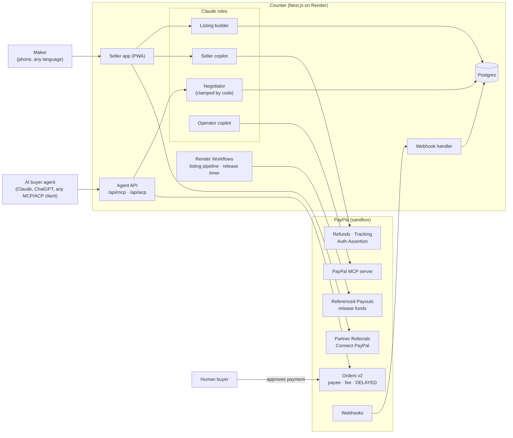
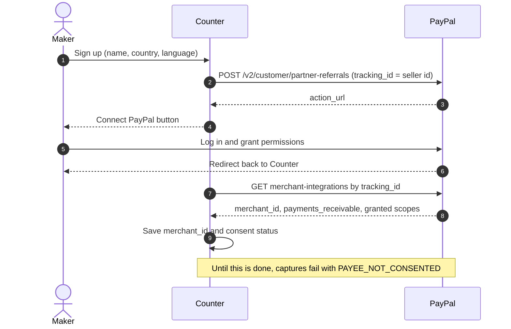
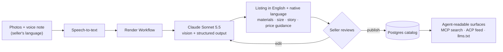
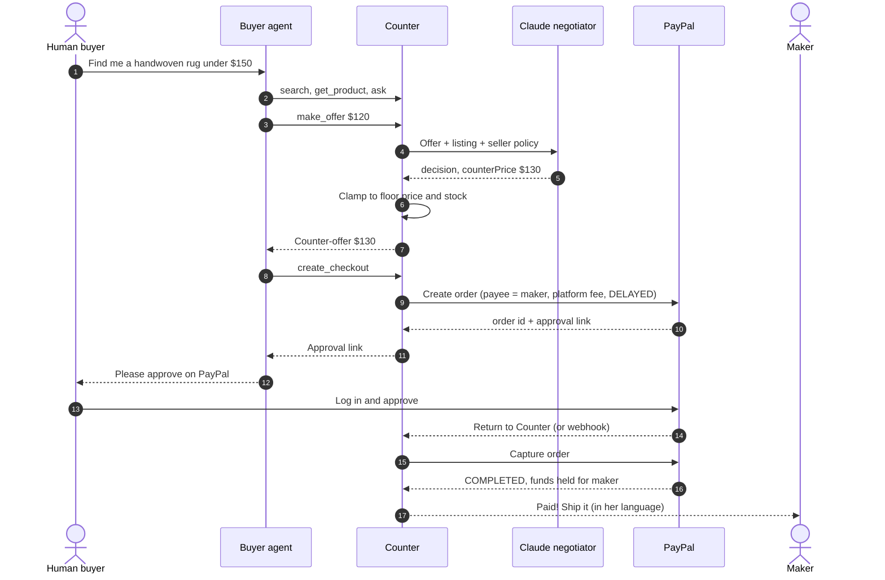
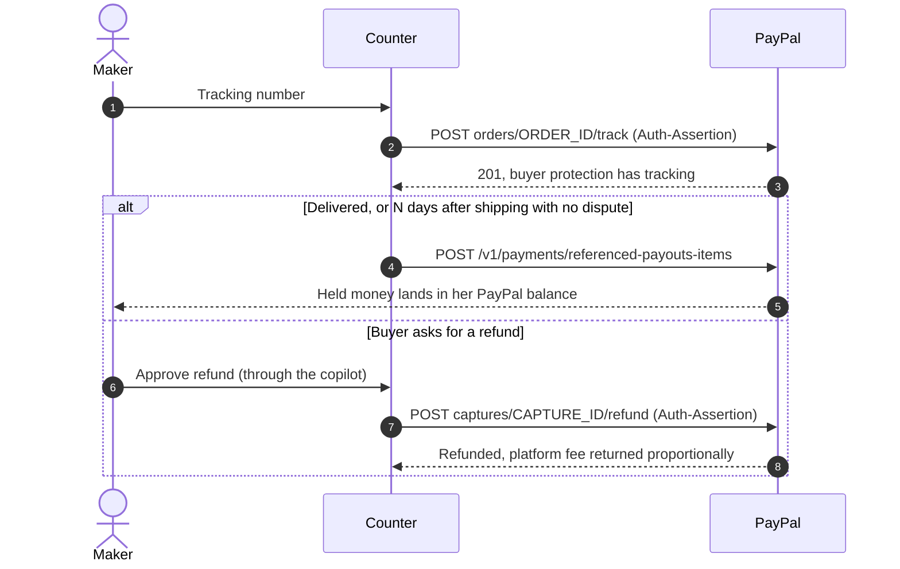
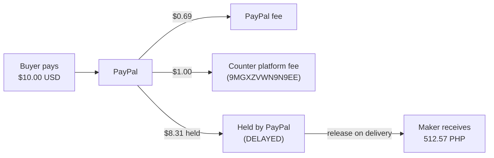
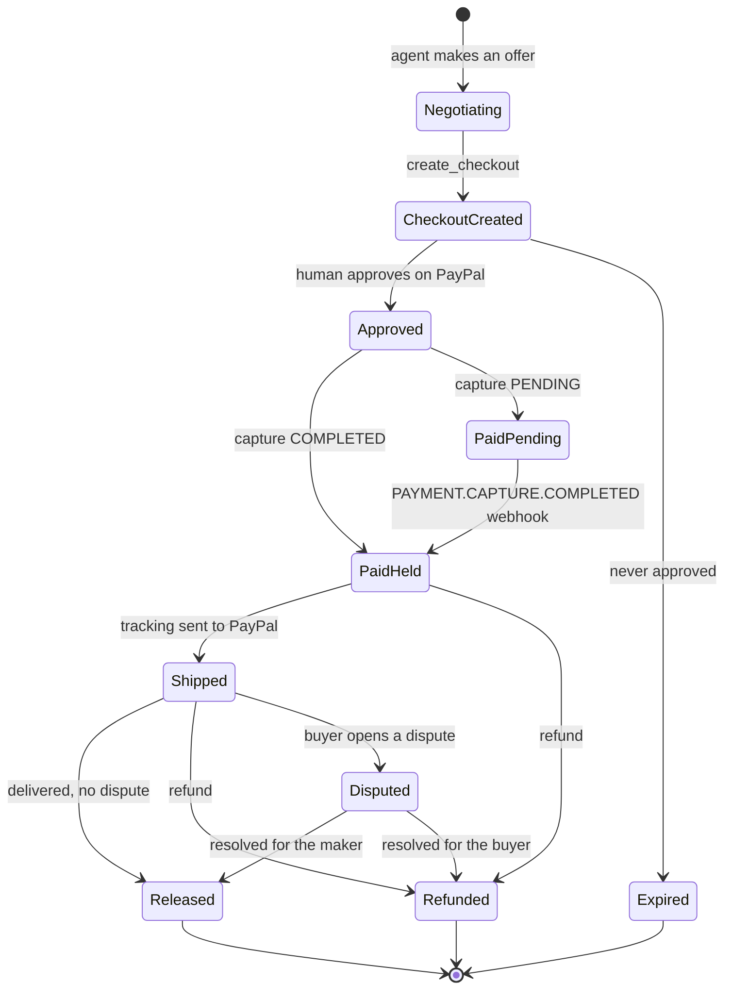
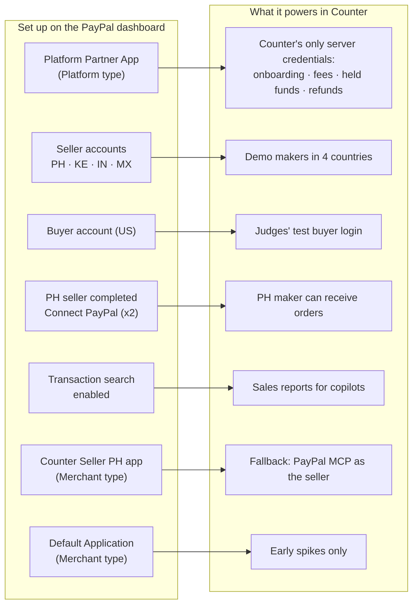

# PayPal AI Hackathon: Docs & Planning

> "Build What's Next with PayPal and AI" · Online, global · Devpost
> Sources: [PayPal blog](https://developer.paypal.com/community/blog/PayPal_AI_Hackathon/) · [Devpost overview](https://paypalaihackathon.devpost.com/) · [Rules](https://paypalaihackathon.devpost.com/rules) · [Resources](https://paypalaihackathon.devpost.com/resources)
> Last updated: 2026-10-24

---

## 1. Key facts

| | |
|---|---|
| **Deadline** | **Thu Nov 12, 2026 @ 12:00 PM PT** (hard; no edits after) |
| Submission opened | Oct 1, 2026, 9:15 AM PT |
| Judging | Dec 1 – Dec 15, 2026 |
| Winners | ~Dec 21, 2026, 2:00 PM PT |
| Time left (from Oct 24) | **~19 days** |
| Participants | ~20,130 registered (very crowded) |
| Prize pool | $67,500+ cash + Render credits |
| Team | Solo or team. Teams appoint one Representative who submits and receives prizes. |
| Eligibility | Age of majority. Excludes Brazil, Quebec, Russia, Crimea, Cuba, Iran, North Korea and other OFAC-sanctioned regions, plus PayPal, Devpost and judges' employers. |
| Language | English (or provide translations) |
| Help | [PayPal Discord](https://discord.com/invite/sJ2G6DyvSK), with sponsor teams in their own channels |

**The one hard rule:** the project must *meaningfully* use **both PayPal and AI**. There are no tracks. "PayPal" includes Venmo, Braintree, Xoom, Honey, Zettle, Hyperwallet, etc. Build in the **sandbox**.

New or existing projects both count. An existing project must be *significantly updated* during the submission period, and the submission must explain what changed.

---

## 2. Submission requirements (checklist)

- [ ] **Working project**: it integrates at least one PayPal API/SDK/product and meaningfully uses AI. Mockups, static prototypes and non-functional demos are rejected.
- [ ] **Text description** of features and functionality.
- [ ] **Functional demo access**, either:
  - [ ] a **hosted demo URL** (preferred, since judges may not bother building it), or
  - [ ] complete setup and run instructions in the repo.
  - Include **test credentials** (sandbox buyer login, any API keys judges need). Keep it free to use and running until **Dec 15**.
- [ ] **Tools section**: which AI models/services were used, and how.
- [ ] **Public repo** (GitHub/GitLab/Bitbucket) with all source, assets and instructions.
  - [ ] An **open-source LICENSE file** that GitHub detects and shows in the About sidebar (e.g. MIT).
- [ ] **Demo video under 3 min**: public on **YouTube**, link on the form.
  - [ ] Shows the project running on its target device.
  - [ ] No copyrighted music or third-party trademarks without permission. Use royalty-free music or none.
- [ ] If the project existed before the hackathon, explain what was built during it.

**Testing note:** judges *may* skip running it and judge only from the video, description and images. **The video carries the most weight.**

---

## 3. Judging

**Stage 1 (pass/fail):** does it fit the theme and reasonably use the required PayPal APIs/SDKs?

**Stage 2:** five **equally weighted** criteria. Ties go to the earlier criterion in this order:

1. **Technological Implementation**: how thoroughly and skillfully the project uses PayPal and AI, as a working, non-trivial build. *(First tiebreaker.)*
2. **Design**: a complete, coherent product, not just a tech proof of concept.
3. **Potential Impact**: a credible, specific real problem for a real audience, solved in what's *demonstrated*.
4. **Innovation/Idea**: novel, and different from existing concepts.
5. **Presentation**: the video shows it working end to end and makes clear what problem it solves, who it's for, and why it matters.

**Judges:** 6 from PayPal (DevRel, engineering, PM) plus one each from AG Grid, APIMatic, Bryntum, Channel3, Elastic, Postman and Render. Judging may also use AI-driven analysis, so a clear README and description matter.

---

## 4. Prizes

| Prize | Amount | # |
|---|---|---|
| 1st / 2nd / 3rd Place | $12,000 / $8,000 / $5,000 | 1 each |
| Most Creative | $5,000 | 1 |
| Most Impactful | $5,000 | 1 |
| Best Demo Delivery | $5,000 | 1 |
| Best Use of PayPal + AI | $5,000 | 1 |
| Best Use of Agentic Commerce | $5,000 | 1 |
| AG Grid: 1st / 2nd / 3rd | $5,000 / $2,000 / $1,000 | 1 / 1 / 3 |
| APIMatic | $1,000 + 6 months of APIMatic Business | 3 |
| Bryntum | $1,000 | 3 |
| Channel3 | $1,500 | 1 |
| Render: 1st / 2nd / 3rd | $1,000 / $750 / $500 in **credits** | 1 each |

**Stacking rule:** a project can win at most **one Grand Prize *or* one Honorable Mention**, plus **one Sponsor Prize**. So target one main category and one sponsor. Sponsor prizes require actually *using* the sponsor's tool; a passing mention doesn't count.

Winners are responsible for their own taxes and fees (W-9 or W-8BEN). Prizes are paid within about 60 days of the forms being returned.

---

## 5. PayPal tech & resources

**Core**
- [Developer docs](https://developer.paypal.com) · [Dashboard (sandbox apps and accounts)](https://developer.paypal.com/dashboard/) · [Sandbox getting started](https://github.com/paypaldev/getting-started-with-paypal-sandbox)
- [Checkout](https://developer.paypal.com/checkout/) · [JS SDK v6](https://developer.paypal.com/sdk/js/) · [REST API](https://developer.paypal.com/api/rest/) · [Payment links/buttons (no-code)](https://developer.paypal.com/payment-links-buttons/overview)
- Capabilities: [Pay Later](https://developer.paypal.com/pay-later/overview) · [Subscriptions](https://developer.paypal.com/platforms/subscriptions) · [Invoicing](https://developer.paypal.com/invoicing/about) · [Payouts](https://developer.paypal.com/docs/payouts/) · [Disputes](https://developer.paypal.com/platforms/disputes/overview) · [Donations](https://developer.paypal.com/sdk/donate/) · [Webhooks](https://developer.paypal.com/api/webhooks/overview)

**AI / agents**
- [PayPal AI docs](https://docs.paypal.ai/)
- [Agent Toolkit quickstart](https://docs.paypal.ai/developer/tools/ai/agent-toolkit-quickstart) · [repo](https://github.com/paypal/agent-toolkit): `@paypal/agent-toolkit` (Node 18+) exposes PayPal actions as LLM tools for the **Vercel AI SDK** (`@paypal/agent-toolkit/ai-sdk`), OpenAI Agents SDK, LangChain and MCP. **There's no Anthropic SDK adapter**, so with `@anthropic-ai/sdk` you either wrap PayPal REST calls as your own tools or use the toolkit through MCP. Tool names include `create_order`, `get_order`, `pay_order`, `create_refund`, `list_disputes`, `get_dispute`, `accept_dispute_claim`, `create_shipment_tracking`, `list_transactions` and `get_merchant_insights`. Sandbox is the default (`PAYPAL_ENVIRONMENT=SANDBOX`).
- [MCP server quickstart](https://docs.paypal.ai/developer/tools/ai/mcp-quickstart): PayPal hosts a **remote MCP server**, at `https://mcp.sandbox.paypal.com` for sandbox and `https://mcp.paypal.com` for production. **Verified Oct 24:** it offers **46 tools** covering invoices (incl. recurring series and auto-reminders), catalog products, subscriptions, shipment tracking, orders, disputes, refunds, transactions and merchant insights, but **no payouts or balance tools**. Endpoints are `/sse` and `/http`, plus `/mcp`, which uses OAuth (see §5.1 for auth). A local `@paypal/mcp` npm server exists too. PayPal is also a partner connector in Claude's Connectors Directory.

**Using PayPal with Claude (there's no `@anthropic-ai/sdk` adapter, but that doesn't block anything)**

| Route | How | Best for |
|---|---|---|
| **PayPal MCP + Claude MCP connector** | `@anthropic-ai/sdk` with `mcp_servers: [{type: "url", url: <PayPal MCP>, name: "paypal", authorization_token}]` + `tools: [{type: "mcp_toolset", mcp_server_name: "paypal"}]`, beta `mcp-client-2025-11-20` | An agent that calls PayPal tools directly. **Spike the auth on day 1** (bearer access token vs OAuth). |
| **Agent Toolkit + Vercel AI SDK** | `@paypal/agent-toolkit/ai-sdk` tools + `@ai-sdk/anthropic` model (Claude) | Fastest TypeScript route. The AI SDK is model-agnostic, so it works with Claude. |
| LangChain | Toolkit's LangChain tools + `ChatAnthropic` | If you're already on LangChain |
| **Own tools over REST** | Wrap `/v2/checkout/orders` etc. as `betaZodTool`s, or call them from plain server code | Money-critical paths where code, not the model, decides (create and capture order) |
| Claude Code / claude.ai | PayPal connector, or `/plugin install paypal@claude-plugins-official` | Development time only |

**PayPal's production agentic commerce products** ([docs](https://developer.paypal.com/docsai/growth/agentic-commerce/overview)) are **not available to hackathon builders**: access is by request, with onboarding through PayPal's AI team, and there's no self-serve sandbox.
- **Agent Ready**: merchants accept payments inside AI assistants. It goes through Braintree, using **ACP** for ChatGPT and **UCP** for Google AI Mode and Gemini.
- **Store Sync**: makes merchant catalogs discoverable to and orderable from AI assistants. It's live on Perplexity and Copilot (ChatGPT and Gemini are rolling out), connects through platforms like Wix, BigCommerce and Shopware, and is **limited to US buyers paying in USD for physical goods**.
- **Gap this leaves:** small independent sellers *outside* those platforms, and *outside the US*, aren't covered. §8 targets that gap.
- [Agent tools reference](https://docs.paypal.ai/developer/tools/ai/agent-tools-ref)
- [PayPal AI-Toolkit plugin](https://github.com/paypal/AI-Toolkit) for Claude Code, Cursor and Codex. Install with `/plugin install paypal@claude-plugins-official`. It adds `/paypal:sandbox`, `/paypal:doctor`, `/paypal:test-accounts` and a sandbox MCP server. The MCP server needs `PAYPAL_SANDBOX_ACCESS_TOKEN` (client-credentials OAuth, roughly 8h lifetime).
- Toolkit/MCP tool categories: **Orders & payments** (create, capture, refund), **Invoices** (create, send, remind, QR code), **Subscriptions** (plans, subscriptions), **Disputes** (list, get, respond), **Catalog** (products), **Shipment tracking**, **Reporting** (list transactions, insights). **Payouts isn't in the toolkit**, so call the REST API directly.

### 5.1 Sandbox verification (Oct 24, our sandbox app `APP-81094253P6311561X`)

Run with client credentials from `.env`, which must stay out of git.

**Dashboard changes log** (sandbox, Apps & Credentials / Testing Tools)

| Date | Change | Notes |
|---|---|---|
| Oct 24 | Created business sandbox accounts PH, KE, IN, MX (emails in the seller table below) | Seller personas for routing spikes |
| Oct 24 | **Default Application** → Features → enabled **Transaction search** | Reporting scope took effect overnight (confirmed Oct 25) |
| Oct 25 | Created app **Counter Seller PH**: type **Merchant**, linked to `sb-eg6qj53475038` (PH). Enabled **Transaction search**. | Creds in `.env` as `SELLER_PH_CLIENT_ID/SECRET`. Default features on: Subscriptions, Payment links and buttons, Payouts, Customer disputes, JS SDK v6, Mobile SDKs. |
| Oct 25 | Created app **Platform Partner App**: type **Platform**, country US | Name is fixed by the dashboard for this type. Auto-generated a new US business account `sb-dg843w53499126@business.example.com` as the platform owner. Features on by default: Expanded checkout, ACDC, Apple Pay, Google Pay, Fastlane, PayPal and Venmo, Save payment methods, Subscriptions, Invoicing, Payment links, Payouts, Customer disputes, Transaction search, JS SDK v6, Mobile SDKs, **Onboard before payment**, **Platform fee**, **Delay disbursement**. Off: IC++, Log in with PayPal, Onboard after payment. Creds go in `.env` as `PLATFORM_CLIENT_ID/SECRET`. |
| Oct 25 | PH seller `sb-eg6qj53475038` completed ISU onboarding to Platform Partner App (referral 1: PAYMENT, REFUND, PARTNER_FEE, DELAY_FUNDS_DISBURSEMENT, ACCESS_MERCHANT_INFORMATION) | Done by the user in the browser |
| Oct 25 | PH seller completed ISU referral 2 (adds ADVANCED_TRANSACTIONS_SEARCH, READ/UPDATE_SELLER_DISPUTE) | Done by the user in the browser |

| Check | Result | Implication |
|---|---|---|
| OAuth client-credentials token | ✅ `expires_in: 32400` (9h) | Cache the token server-side and refresh it before it expires |
| Scopes granted by default | Include `payments/.*`, `payments/payouts`, `refund`, `invoicing`, `subscriptions`, `disputes/read-seller`, `disputes/update-seller`, `disputes/create`, `webhooks`, `pricing/exchange-currency/read`. **Missing: `reporting/search/read`** | Payouts and disputes are open by default. Reporting needs enabling (below) |
| Orders v2 `CAPTURE` in USD, EUR, MXN, PHP, JPY | ✅ 200, `PAYER_ACTION_REQUIRED` + `payer-action` link | Multi-currency checkout works |
| Orders v2 in **INR, KES** | ❌ 422 `CURRENCY_NOT_SUPPORTED` | **You can't charge in INR or KES.** Price Indian and Kenyan sellers in USD or EUR and show local-currency figures for reference only. |
| `payee.email_address` set to a **nonexistent** email | ⚠️ 200 at create | PayPal doesn't check the payee when the order is created. Approve and capture against a **real second sandbox business account** before trusting it, and validate seller emails at onboarding. |
| `payment_instruction.platform_fees` | ❌ 422 `PLATFORM_FEES_NOT_SUPPORTED` ("work with your PayPal Account Manager") | Default (Merchant) app only. **Superseded Oct 25:** fees work with the Platform-type app after seller consent (below). |
| Reporting `/v1/reporting/transactions` and `/balances` (also the MCP `list_transactions` tool) | ❌ 403 `NOT_AUTHORIZED` | Enable **Transaction Search** on the app in the dashboard (Apps & Credentials → app → Features). It can take hours to take effect. Until then, the copilot reads transactions from our own DB. |
| Catalog products, disputes, webhooks list | ✅ 200 (empty) | Ready to use |
| Payouts `POST /v1/payments/payouts` ($1 to a placeholder email) | ✅ 201, batch `PENDING` | Payouts works in the sandbox with no extra setup (useful for idea E) |
| Card `payment_source` with `payee` set to a seller sandbox account | ❌ 422 `PAYEE_NOT_ENABLED_FOR_CARD_PROCESSING` (3 sellers); `PAYER_CANNOT_PAY` (seller 4) | For payee-routed orders, take payment through the **PayPal wallet** (buyer approval link). Card payments only work if each seller has advanced card processing. |
| **End to end: wallet order with `payee` → US buyer approves → capture**, sent to 4 seller accounts (see the next table) | ✅ 6/7 `COMPLETED`; ⚠️ 1 `PENDING` | **Spikes 1 and 2 pass.** The money reaches each seller's account and is converted to the seller's home currency where needed. |
| Transaction Search enabled + saved | ⏳ the new token still has no reporting scope; still 403 | Propagation delay; re-check later |

**Seller sandbox accounts** (business): `sb-eg6qj53475038` = **PH**, `sb-cnnt753377415` = **KE**, `sb-ei6l4350837767` = **IN**, `sb-oegvy53432233` = **MX**, all `@business.example.com`. The default `sb-0dlhe53539354@business.example.com` (US) is the app owner, and `sb-xkveo53530182@personal.example.com` (US) is the buyer.

**Capture results** (US buyer, Oct 24):

| Seller | Charged | PayPal fee | Seller receives | Notes |
|---|---|---|---|---|
| PH | 10.00 USD | 0.69 USD | **574.25 PHP** | Auto-converted at 61.68 |
| PH | 200.00 MXN | 11.80 MXN | **615.39 PHP** | Cross-currency (MXN→PHP) works |
| KE | 10.00 USD | 0.69 USD | **9.31 USD** | KE accounts hold USD (KES can't be charged anyway) |
| IN | 10.00 USD | 0.81 USD | **9.19 USD** | Kept in USD |
| IN | 10.00 EUR | — | — | ⚠️ Capture `PENDING`, reason `RECEIVING_PREFERENCE_MANDATES_MANUAL_ACTION`. The seller must accept the EUR payment by hand in their account. |
| MX | 10.00 USD | 0.87 USD | **165.36 MXN** | Auto-converted at 18.11 |
| MX | 500.00 PHP | 40.80 PHP | **130.79 MXN** | Cross-currency works |

**Implications:**
- **Charge in USD by default** (every seller accepts it automatically). For EU buyers, charge in EUR only for sellers whose accounts take EUR without manual acceptance (PH and MX do). For IN, use USD, or show a "seller must accept" state, and handle `PENDING` captures (webhook `PAYMENT.CAPTURE.COMPLETED` arrives later).
- The buyer sees PayPal's conversion at approval (e.g. 200 MXN shown as $11.05). The seller pays fees of about 6.9–8.7% on cross-border sandbox payments. Show the net amount in the seller app.
- `payee.email_address` isn't echoed back in the capture response. Store the seller ↔ order mapping in our DB.

**Post-sale actions on payee-routed captures (Oct 24):**

| Check | Result |
|---|---|
| Refund (`POST /v2/payments/captures/{id}/refund`) with the **platform** token, on the KE and PH captures | ❌ 403 `PERMISSION_DENIED` |
| Shipment tracking (`POST /v2/checkout/orders/{id}/track`) with the **platform** token | ❌ 403 `PERMISSION_DENIED` |
| Partner Referrals (`/v2/customer/partner-referrals`, for third-party onboarding with REFUND and PARTNER_FEE) | ❌ 403 `NOT_AUTHORIZED` on the Default (Merchant) app. **Superseded Oct 25:** works on the Platform-type app (below). |

**Consequence:** the platform can *create* orders for a seller, but it can't act on the seller's captures afterwards. Refunds, tracking and disputes need the **seller's own credentials**. → **Decision: sellers connect their own PayPal REST app** (client ID and secret, stored encrypted). Post-sale calls and the seller's PayPal MCP copilot session use the seller's token. **Superseded Oct 25:** the Platform-type app gives one-click Connect PayPal (ISU) in the sandbox, so seller-owned apps are now only a fallback (see below).

**Seller-owned app (Oct 25, app "Counter Seller PH", Merchant type, linked to `sb-eg6qj53475038` PH, Transaction Search on):**

| Check (seller token, on platform-created payee-routed orders) | Result |
|---|---|
| Token scopes | Include `payments/refund`, `shipping/trackers/readwrite`, `reporting/search/read` (immediately, no propagation delay), `disputes/*`, payouts |
| `GET /v2/payments/captures/{id}` | ✅ 200 |
| Partial refund $1 on USD capture | ✅ 201 `COMPLETED`; capture now `PARTIALLY_REFUNDED` |
| Tracking v2 `POST /v2/checkout/orders/{id}/track` | ✅ 201 (tracker not echoed in `GET order`; confirm in seller UI) |
| Tracking v1 `POST /v1/shipping/trackers-batch` on MXN capture | ✅ 200; `GET` tracker → `SHIPPED` `DHL` |
| `/v1/reporting/transactions` | ✅ 200, 6 rows (seller's own sales) |
| Remote MCP `/sse` with seller token | ✅ 46 tools; `list_transactions` returns seller's transactions; `get_order` works on platform-created order |

**Spike passes.** Platform creates orders → seller token handles refunds, tracking, reporting and the MCP copilot. Fallback (platform as merchant of record + Payouts) not needed. Also: the platform token now has `reporting/search/read` (Transaction Search propagated overnight).

**Platform-type app (Oct 25, "Platform Partner App", partner merchant ID `9MGXZVWN9N9EE`):** this unblocks fees, held funds and one-click onboarding.

| Check (Platform app token) | Result |
|---|---|
| Token scopes | Adds `payments/partnerfee`, `customer/partner-referrals/readwrite`, `partners/merchant-accounts/readwrite`, `payments/referenced-payouts-items/readwrite`, `customer/onboarding/*` |
| `POST /v2/customer/partner-referrals` (ISU) | ✅ 201 + `action_url`. Features the app allows: PAYMENT, REFUND, PARTNER_FEE, DELAY_FUNDS_DISBURSEMENT, ACCESS_MERCHANT_INFORMATION, ADVANCED_TRANSACTIONS_SEARCH, READ/UPDATE_SELLER_DISPUTE, VAULT. ❌ 422 `FEATURES_UNAUTHORIZED`: TRACKING_SHIPMENT_READWRITE, INVOICE_READ_WRITE |
| Create order with `payee` + `platform_fees` and/or `disbursement_mode: DELAYED` | ✅ 200 at create |
| Capture **before** the seller onboards | ❌ 403 `PAYEE_NOT_CONSENTED` |
| PH seller completes ISU link (features PAYMENT, REFUND, PARTNER_FEE, DELAY_FUNDS_DISBURSEMENT, ACCESS_MERCHANT_INFORMATION) → capture | ✅ 201 `COMPLETED`. $10 gross − $0.69 PayPal fee − **$1.00 platform fee** (to `9MGXZVWN9N9EE`) = $8.31 → **512.57 PHP** to seller |
| Capture with `DELAYED` | ✅ `disbursement_mode: DELAYED`, funds held |
| Release held funds `POST /v1/payments/referenced-payouts-items` `{reference_id: <capture>, reference_type: TRANSACTION_ID}` | ✅ 201 `SUCCESS` |
| Refund / v2 tracking with platform token, **no** assertion | ❌ 403 `PERMISSION_DENIED` |
| Same, with header `PayPal-Auth-Assertion` (unsigned JWT `{alg:none}.{iss: <platform client_id>, payer_id: <seller merchant_id>}.`) | ✅ refund $2 201 (platform fee refunded proportionally: $0.20, seller net $1.80) · ✅ v2 `orders/{id}/track` 201 |
| v1 `trackers-batch` and `/v1/reporting/transactions` with assertion | ❌ 403 (features not granted in the first referral; reporting needs ADVANCED_TRANSACTIONS_SEARCH) |

Notes:
- The seller's `merchant_id` isn't in `GET order` (`payee.merchant_id` empty), but `GET /v2/payments/captures/{id}` returns `payee.merchant_id` (PH = `MPMWEFYQWQYUA`). In the app, store it from the ISU return URL / `merchant-integrations` lookup at onboarding.
- **Architecture change:** use the Platform app + ISU "Connect PayPal" instead of sellers pasting client ID/secret. Money: `payee` + `platform_fees` + `DELAYED` → release on delivery (or after N days). Post-sale: platform token + `PayPal-Auth-Assertion`. Seller-owned app stays as fallback for tracking v1 / invoicing.
- **Referral 2** (adds ADVANCED_TRANSACTIONS_SEARCH, READ/UPDATE_SELLER_DISPUTE), completed by PH seller Oct 25:

| Check | Result |
|---|---|
| `GET /v1/customer/partners/9MGXZVWN9N9EE/merchant-integrations/MPMWEFYQWQYUA` | ✅ 200, `payments_receivable: true`. Granted: `delay-funds-disbursement`, `partnerfee`, `refund`, `authcapture`, `reporting/search/read`, `disputes/read-seller`, `disputes/update-seller`, `merchant-integrations/read` |
| `/v1/reporting/transactions` with assertion | ❌ 403 `NOT_AUTHORIZED` (twice, fresh tokens), even though the grant is listed. Likely propagation delay like Oct 24; re-check later |
| `GET /v1/customer/disputes` with assertion | ❌ 403 (same) |
| v1 `trackers-batch` with assertion | ❌ 403 (tracking feature can't be requested by this app; use v2 `orders/{id}/track`) |
| PayPal remote MCP `/sse` with platform token ± `PayPal-Auth-Assertion` | ⚠️ Works, but **ignores the assertion**: `list_transactions` returns the platform's own account (`9MGXZVWN9N9EE`), not the seller's |

**Copilot consequence:** the PayPal MCP server can't act *as* a seller through the platform. Options: (a) copilot uses our own `betaZodTool`s over REST with the assertion header (refund, v2 tracking, and reporting/disputes once grants propagate), or (b) copilot uses PayPal MCP with a seller-owned app token (proven Oct 25). Demo: (a) for the seller-facing copilot, plus PayPal MCP on the platform token for the **platform operator's** view (fees earned, held funds).

**Fallback model (not needed; kept for reference):** make the platform the merchant of record (payee = platform) and pay sellers with **Payouts**. That gives refunds, tracking and a fee margin on one token. The costs: the platform becomes the seller of record, so buyer protection is with the platform, plus a regulatory story to tell, and payout fees and delay. Weaker pitch ("money goes straight to the maker" is lost).
| Remote MCP `/sse` with `Authorization: Bearer <client-credentials token>` | ✅ handshake, `initialize`, `tools/list` (46 tools), `tools/call` | **Spike 5 passes.** No user OAuth is needed: mint the token server-side and pass it to Claude's MCP connector as `authorization_token`, with the URL `https://mcp.sandbox.paypal.com/sse`. |
| Remote MCP `/mcp` | 401 with no token; 404 with a client-credentials token | `/mcp` is the OAuth (dynamic client registration + PKCE) endpoint. **Use `/sse`.** |
| `x-feature-flags: commerce:true` header | No extra tools | The `search_product`, `create_cart` and `checkout_cart` commerce tools aren't exposed to our app |

**Still to verify:** the webhook to Render, and whether accepting the pending IN EUR capture by hand works. (Transaction Search, refunds and tracking on payee-routed captures: ✅ Oct 25.)

**Webinar recordings**
- [Start building with PayPal (Oct 6)](https://www.youtube.com/watch?v=FFJfCW9z3Do) · [APIMatic Context Plugins (Oct 7)](https://youtu.be/zRWixN68tDg) · [Payments dashboard with AG Grid (Oct 12)](https://www.youtube.com/watch?v=LGfG44i1Fj8) · [Start building with PayPal, APAC session (Oct 13)](https://youtu.be/ck_zyB66p_Y)

**PayPal's own inspiration list** (expect many entries on these themes): an agent that shops and checks out, auto-paying contractors when a job is done, agent-to-agent negotiation and settlement, receipt-scan bill splitting, freelancer multi-client dashboards, marketplace split payments, creator tipping, a budgeting app that categorizes transactions, accessible donation platforms, microloans, and community money pools.

---

## 6. Sponsor tools: perks & prize criteria

| Sponsor | What it is | Free access | What wins its prize |
|---|---|---|---|
| **AG Grid** | AG Studio, an embeddable self-serve dashboard with grids, charts, cross-filtering and the **Studio Agent Framework** (agents build, query and edit dashboards) | 45-day trial · [PayPal + AG Studio boilerplate](https://github.com/paypaldev/hackathon-paypal-ag-grid-boilerplate) | Polish: custom widgets, theming and layout, not plain grids or charts. Use the Studio Agent Framework, either a custom agent talking to Studio's built-in agents or a swapped-in harness. Their ideas: NL finance agent, refund-anomaly agent, donation dashboard, invoice "nudge-bot". |
| **APIMatic** | Context Plugin that gives AI coding agents (e.g. Claude Code) PayPal API context | 1 month free of Basic ([claim form](https://docs.google.com/forms/d/e/1FAIpQLScc2oCgAFACm7d6H3R4mgzv-O34DdyVnLIBNiwmUNggr_-hhA/viewform)) · [setup info](https://drive.google.com/file/d/1qa7Xkjt3PGJllHQVCP1IuE-XxlRNz4mN/view) | Use the plugin to build your PayPal integration. **The cheapest sponsor prize to qualify for**, since it's a dev-time tool. Document the usage in the README and video. |
| **Bryntum** | Gantt, Scheduler and Calendar web components (React/Vue/Angular) | 45-day trial: `npm install @bryntum/scheduler@npm:@bryntum/scheduler-trial` | Best use of Gantt, Scheduler or Calendar, e.g. "an agent that drives the schedule itself". Their ideas: dispute triage board, payment-gated rental calendar, milestone Gantt with payment dependencies, agent rescheduler on payment events. |
| **Channel3** | One API or MCP server for normalized product data (100M+ products, 25k+ retailers) | 20k credits with code `PAYPAL-HACKATHON-2026` at [trychannel3.com/developers](https://trychannel3.com/developers). They top up on Discord if you run out. | Must actually **call** the API or MCP server as a meaningful part of the product (search, enrichment, recommendations). |
| **Render** | Hosting plus **Render Workflows** (distributed task orchestration for agents and jobs) | [$50 credits](https://credits-portal-mmdm.onrender.com/claim/paypal-ai-hackathon) | Deploy on Render and use Workflows to coordinate agents and jobs. Prizes are credits only. **Use it anyway for the hosted demo URL.** |
| Kernel | Cloud browsers for agents (CUA, auth persistence, live view) | [$50 credits](https://dashboard.onkernel.com/hackathon?code=KERNELDEVPOST2026) | No prize |
| Elastic | Elasticsearch: hybrid/vector search, Agent Builder, ES\|QL | 14-day trial plus a 30-day self-extension · [signup](https://ela.st/elastic-paypal-hackathon) | No prize (but an Elastic judge) |
| Astropods | Agent runtime and deploy platform | [Free account](https://astropods.com/) | No prize |
| Postman | API design and testing | [PayPal collection](https://www.postman.com/paypal) | No prize (but a Postman judge) |
| Zapier | Zapier MCP: AI actions across 9k+ apps, including PayPal | 14-day Pro trial | No prize |

---

## 7. Idea review

Scoring: **Fit** = how well it maps to the judging criteria and a prize · **Crowd** = expected competition (more ★ = less crowded) · **Feasibility** = can 1–2 people ship a polished version in about 19 days, *given what the PayPal sandbox actually supports*.

### Measured crowding (checked Oct 24)

Public GitHub repos created since Oct 1 whose name or description matches the keywords. This is a lower bound: many entries are private until submission, and ~20k people have registered.

| Keywords | Repos | Read |
|---|---|---|
| paypal + dispute | **55** | Saturated. Dozens of "AI dispute copilot / desk / defender" entries. |
| paypal + payout | 46 | Crowded |
| paypal + shopping agent | 37 | Crowded |
| paypal + refund | 36 | Crowded |
| paypal + invoice agent | 34 | Crowded |
| paypal + escrow | 31 | Crowded |
| paypal + subscription | 30 | Crowded |
| paypal + milestone | 23 | Crowded |
| paypal + agentic checkout | 21 | Mostly *buyer-side* checkout agents |
| paypal + voice | 12 | Moderate |
| paypal + split | 10 | Moderate |
| paypal + bryntum | 8 | Sponsor prize looks winnable |
| paypal + agent marketplace / agent-to-agent | 6 + 2 | Low, mostly "two agents haggle" demos |
| paypal + donation | 6 | Low |
| paypal + accessibility | 1 | Very low |
| paypal + scam (mostly scam protection for seniors) | 8 | Moderate |
| paypal + savings circle (ROSCA, tanda, susu, ajo) | 2 | Low (CirclePay, ajo-agent) |
| paypal + ACP / store sync / remittance / unbanked | 0 | Empty |

**Takeaway:** every obvious idea has competitors. Winning comes from a **specific audience, a polished end-to-end flow, and a great video**, not from the category alone. Avoid the saturated categories, because judges will see the same pitch dozens of times.

### Suggested ideas (from the brainstorm)

| # | Idea | Target prizes | Fit | Crowd | Feasibility | Verdict |
|---|---|---|---|---|---|---|
| 1 | **Haggle**: shopping agent with a budget and spend policy | Agentic Commerce + Channel3 | ★★★★ | ★ | ★★★ | Strong fit but it's **PayPal's #1 example idea**, so expect hundreds. One catch: Channel3 returns third-party retailer links, and PayPal can't pay arbitrary retailers, so the "checkout" has to go to your own sandbox merchant. Only worth doing with a sharp twist (see A). |
| 2 | **Dispute Copilot** for small merchants | Most Impactful / Best Use of PayPal + AI + Bryntum or AG Grid | ★★★★★ | ✗ (55 repos) | ★★ | **Dropped.** Strong rubric fit, but it's the most crowded idea in the hackathon. Sandbox disputes are also awkward: the create endpoint needs the `DISPUTE_CREATE` scope, which was thought to need a PayPal account manager. Our sandbox token does include `disputes/create`, but the endpoint is untested. Otherwise the fallback is a manual INR/SNAD case from a sandbox buyer account paid by card. |
| 3 | **"Ask your money"** chat dashboard for sellers | AG Grid (5 prize slots, $10k total) | ★★★ | ★★ | ★★★★ | Easy start thanks to the boilerplate, but AG Grid's own idea list includes exactly this, so many entrants will build it. Weak on Innovation. Better as a *feature* inside idea 2 than as the product. |
| 4 | **Milestone-to-invoice** for freelancers | Bryntum + Best Use of PayPal + AI | ★★★★ | ★★★ | ★★★★ | Solid. The Invoicing API is mature in the sandbox (create, send, remind). It's an obvious fit for Bryntum Gantt. Upgrade it to escrow (see B). |
| 5 | **Receipt-snap group split** | Most Creative? | ★★ | ★ | ★★ | On PayPal's inspiration list, so it'll be common. **PayPal has no consumer P2P "request money" API.** You'd fake it with invoices or a central Orders/Payouts flow. Low innovation. **Skip.** |
| 6 | **Subscription detective** (consumer) | Most Impactful? | ★★ | ★★★ | ★ | **Not feasible as described.** PayPal APIs don't expose a *consumer's* subscriptions with other merchants. The Subscriptions API is merchant-side only. **Skip** (or flip it to merchant-side churn prediction). |
| 7 | **Agents paying agents** marketplace | Agentic Commerce / Most Creative | ★★★ | ★★★ | ★★ | A great "what's next" story, but abstract: it's hard to show a *real audience* (Impact) and easy to look like a toy. PayPal lists agent-to-agent as an example too. High variance. |
| 8 | **Pay-to-steer live story** | Most Creative / Best Demo Delivery | ★★★ | ★★★★ | ★★★★ | Fun and clip-friendly, but the PayPal use is shallow (just Orders), so it scores weakly on Tech Implementation and Impact. Good as a backup or second, low-effort submission. |
| 9 | **Voice checkout for accessibility** | Most Impactful | ★★★ | ★★★ | ★★ | Good intent, but "pay my nephew back" needs P2P (not available) and "reorder pharmacy items" needs a real merchant. Works only as an accessible voice checkout *for a merchant's store*. Narrower than pitched. |

### Additional ideas

| # | Idea | Target prizes | Why |
|---|---|---|---|
| **A** | **Agent-Ready Storefront**: a seller-side kit that turns a small merchant's catalog into something AI shopping agents can discover, negotiate with and pay (an MCP endpoint backed by the PayPal Catalog and Orders APIs, with policy-bound auto-discounts the seller sets). The demo shows a buyer agent (e.g. Claude) buying from the shop end to end. | Agentic Commerce + AG Grid | Most entrants build the *buyer* agent; few build the *merchant* side of agentic commerce. A handful of similar repos exist (e.g. agentshelf, ShopGenie, skuuy), versus 37+ buyer-side shopping agents. It ties directly to PayPal's strategy, and the real audience is small merchants. Harder to demo emotionally. **Top pick, expanded to cross-border makers in §8.** |
| **B** | **Proof-of-Work Escrow** (an upgrade of idea 4): the client funds a milestone through an Orders `AUTHORIZE` intent. When the freelancer submits the deliverable, AI checks it against the acceptance criteria (e.g. diffs a repo, inspects images, reads a doc), then recommends capture, partial capture or a revision request. The client approves with one click, and the Bryntum Gantt updates. | Best Use of PayPal + AI + Bryntum | Deeper PayPal use than invoices (authorize, capture, void, refund) and a credible trust problem for freelancers. It matches a PayPal example ("pays contractors when a job is marked complete") but with an AI verifier, which is the novel part. **Crowded now** (31 escrow + 23 milestone repos). |
| **C** | **Post-Purchase Copilot** (an expansion of idea 2): one agent for refund requests (photo evidence through vision, policy check, auto-refund within limits), shipment-tracking anomalies, and disputes, with a human-approval queue. | Best Use of PayPal + AI | It touches **Orders, Refunds, Shipment Tracking, Disputes and Transactions**, which is the widest legitimate Agent Toolkit coverage of any idea and scores highest on Tech Implementation. Risk of scope creep. **Crowded now** (55 dispute + 36 refund repos). |
| **D** | **Community Pool**: neighbors pool money for a shared goal (solar co-op, cleanup fund). AI drafts the proposal and budget, checks spending against receipts, and the treasurer pays vendors through Payouts. | Most Impactful | It's on PayPal's social-impact list, so it'll be moderately crowded. Emotionally strong, but the AI role can look bolted on. |
| **E** | **AI-run savings circle** (ROSCA, tanda, susu, ajo, chit fund): a multilingual chat agent runs the circle. It collects contributions (Orders, Vault or Subscriptions), pays out the pot (Payouts), handles payout-order swaps, mediates late payments, and produces an exportable payment-history record. | Most Impactful | Huge, specific underserved audience (immigrant and emerging-market communities), and only 2 similar repos. Weaker on agentic commerce, and pooled funds raise trust and regulatory questions the pitch must answer. **Runner-up (see §8).** |
| **F** | **Agents as assistive tech for commerce**: a screen-reader- and voice-first agent shops and pays for blind or low-vision users, with confirmation steps they can hear. | Most Impactful | Near-empty category. But the agent needs stores it can actually buy from, which is the problem §8 solves. **Folded into §8** as a demo beat rather than built separately. |

---

## 8. Recommendation (full-team scope · TypeScript · Claude)

### Pick: **Counter: agentic commerce for the world's small makers** (locked Oct 25)

**Problem:** AI agents are becoming a real shopping channel, but only big merchants are reachable through them. PayPal's own Store Sync and Agent Ready products require a request-only onboarding, a commerce platform (Wix, BigCommerce, Shopware), **US buyers paying in USD, and physical goods**. Independent makers, especially cross-border sellers in places like Oaxaca, Jaipur, Nairobi and Manila, are invisible to agents. Those are the people PayPal's cross-border network already serves.

**Product:** a seller taps **Connect PayPal** once, then sends photos and a voice note **in their own language** from their phone. Within a minute, Counter has listed the product for AI agents worldwide: a translated, structured, agent-readable catalog with provenance, plus price guidance in the buyer's currency. Any AI agent (Claude, ChatGPT, others) can find the product, ask questions, negotiate within the seller's rules, and check out with **PayPal**. The human buyer approves the payment. **PayPal holds the seller's money until the order is delivered**, then Counter releases it straight into the seller's own PayPal account, minus a small Counter fee. Tracking is pushed to PayPal for buyer protection. The seller runs everything through a copilot in their own language.

**Why held funds are the trust story:** a buyer in Berlin has never heard of a weaver in Oaxaca, and an agent picked the rug for them. Holding funds until delivery gives the buyer a reason to trust an unknown maker. The maker is still paid directly by PayPal: Counter never touches the money and never stores seller PayPal passwords or secrets.

**Business model (proven in sandbox):** a per-sale **platform fee** (configurable, e.g. 5%) taken by PayPal at capture and paid to Counter's PayPal account. On a refund, the fee is refunded proportionally (verified: a $2 refund on a $10 sale with a $1 fee returned $0.20 of fee).

**Why this beats the alternatives on the rubric**

| Criterion | Why it scores |
|---|---|
| **Impact** | A specific audience (cross-border micro-sellers) and a specific, timely gap that PayPal's own products leave open. Held funds solve the real trust problem of buying from an unknown maker abroad. The demo shows a real seller story end to end. |
| **Innovation** | Most of the field builds *buyer* agents (37+ shopping-agent repos). Merchant-side, cross-border, any-language agent commerce with escrow-like held funds is close to empty (0 repos matching ACP, Store Sync or remittance). |
| **Tech** | Uses PayPal's **platform** stack for real: Partner Referrals (one-click seller onboarding), Orders v2 with `payee` routing + `platform_fees` + `DELAYED` disbursement, Referenced Payouts to release funds, refunds and shipment tracking on the seller's behalf via `PayPal-Auth-Assertion`, webhooks, and the PayPal MCP server. Claude does vision, translation, structured output, negotiation with policy enforced in code, and copilot tool use; Counter is both an MCP server and an MCP client. |
| **Design** | Two polished surfaces: a mobile-first seller app and a buyer experience with agents. |
| **Presentation** | Emotional and visual: a weaver's voice note becomes a sale through an AI agent a continent away, and she gets paid when the rug arrives. |
| **Prizes** | Best Use of Agentic Commerce, Most Impactful or Best Use of PayPal + AI, plus the Grand prizes. **Sponsor: AG Grid** (1st place pays $5k; the AG Studio seller dashboard). |

**Accessibility beat (idea F):** a store agents can read is also a store blind and low-vision buyers can use through an agent. Show 15 seconds of a voice-only purchase in the video. It costs little and strengthens the impact story.

### Spike status (details in §5.1)

| # | Risk | Status |
|---|---|---|
| 1 | Route money to each seller | ✅ `payee` routing captured end to end to PH, KE, IN, MX sellers |
| 2 | Cross-border currencies | ✅ USD works for every seller (PH and MX auto-convert). ❌ INR and KES can't be order currencies. ⚠️ IN + EUR stays `PENDING` until the seller accepts it by hand |
| 3 | Human approval | ✅ `payer-action` link: "the agent shops, the human pays" |
| 4 | Claude MCP connector → Counter's MCP endpoint | ⏳ Do with the first Render deploy |
| 5 | Claude MCP connector → PayPal MCP server | ✅ `/sse` + client-credentials bearer token. It ignores `PayPal-Auth-Assertion`, so it only sees **Counter's own** account (operator view) |
| 6 | Negotiation safety | ⏳ Floor price, max discount and stock enforced in code; show a blocked prompt injection |
| 7 | Platform fee | ✅ Platform-type app + seller consent |
| 8 | Hold funds, then release | ✅ `disbursement_mode: DELAYED` + `POST /v1/payments/referenced-payouts-items` |
| 9 | Act for the seller after the sale | ✅ Refund and v2 tracking with `PayPal-Auth-Assertion`. ⏳ Reporting and disputes 403 despite being granted (propagation?) |
| 10 | One-click seller onboarding | ✅ Partner Referrals `action_url` → seller consents → `merchant-integrations` confirms |
| 11 | Webhooks to Render | ⏳ Not tested |

**Sandbox constraints the build must respect**
- Every demo seller must finish **Connect PayPal** before a capture, or it fails with `PAYEE_NOT_CONSENTED`. PH is done; onboard KE, IN and MX the same way.
- Charge in **USD** by default (EUR, MXN, PHP also work). Show INR and KES for reference only.
- Buyers pay with the **PayPal wallet**. Card payments to a payee failed on the Merchant app; not re-tested on the Platform app.
- Use **v2** `orders/{id}/track` for tracking. v1 `trackers-batch` is denied, and the Platform app can't request the tracking or invoicing features.
- Don't rely on `GET order` for the seller's merchant ID. Store it at onboarding.

**Overlap watch:** a few repos come close (agentshelf, ShopGenie). Stand out on any-language cross-border onboarding, held funds released on delivery, payment routing to each seller, and openness to many agent ecosystems.

### Runner-up: **AI-run savings circle** (idea E)
Choose it if you want the purest Most Impactful play over Grand and agentic commerce. It has an equally strong audience and 2 competitors, but scores lower on the agentic commerce side and needs a careful answer on trust and regulation for pooled funds.

**Rejected:** Dispute Copilot (saturated), Escrow and Milestone (crowded), Haggle (crowded on the buyer side), and Pay-to-steer story (shallow PayPal use).

---

## 9. Stack & architecture

| Layer | Choice | Why |
|---|---|---|
| App | **Next.js (App Router) + TypeScript**, Tailwind + shadcn/ui; seller side as a mobile-first PWA | One codebase for the seller app, buyer pages, API, MCP and ACP endpoints |
| DB / jobs | Postgres (Render) + Drizzle ORM · **Render Workflows** for the listing pipeline (photos → listing → translations → catalog) and for the release timer (held funds) | Typed and durable. Workflows also qualifies for Render, which is a fallback sponsor |
| Validation | **Zod** at every boundary: env vars, MCP tool inputs, ACP request bodies, webhook payloads (after signature check), PayPal responses, Claude structured outputs. `drizzle-zod` derives insert/select schemas from the Drizzle tables | Agent input is untrusted; one schema source for DB, API and AI |
| PayPal credentials | **One Platform-type app** ("Platform Partner App", partner merchant ID `9MGXZVWN9N9EE`), client credentials on the server only (`PLATFORM_CLIENT_ID/SECRET`). Per seller, store only `merchant_id` + consent status | No seller secrets to store or leak. Acting for a seller = platform token + `PayPal-Auth-Assertion` |
| PayPal (server code) | Partner Referrals + Merchant Integrations (onboarding) · Orders v2 (`payee.merchant_id`, `platform_fees`, `disbursement_mode: DELAYED`, capture) · Referenced Payouts (release) · Refunds + v2 tracking (with assertion) · Webhooks · JS SDK v6 on the human approval page | Money paths are decided by code, never by the model |
| PayPal (AI) | Seller copilot: Claude tool runner over **our own REST tools** (with assertion). Operator copilot: **PayPal remote MCP server** via Claude's MCP connector on the platform token (fees earned, held funds, transactions) | PayPal MCP can't act as a seller, but it's a strong operator view for Best Use of PayPal + AI |
| Agent-facing API | MCP server (`@modelcontextprotocol/sdk`, Streamable HTTP, `/api/mcp`) + **ACP-shaped checkout REST** (create, update, complete, cancel) + a public catalog feed and `llms.txt` | Any agent ecosystem can buy, not just Claude |
| AI | `@anthropic-ai/sdk` (roles below) · speech-to-text for voice notes (browser Web Speech API or an STT service; Claude doesn't take audio input) | |
| Seller analytics | **AG Studio** + Studio Agent Framework (custom widgets and theming, from the [boilerplate](https://github.com/paypaldev/hackathon-paypal-ag-grid-boilerplate)) | Targets the AG Grid sponsor prize |
| Hosting | Render web service + Postgres + Workflows | $50 credits and a public URL from day 1 |
| Dev tooling | Claude Code + PayPal AI-Toolkit plugin + APIMatic Context Plugin | Faster integration |
| Fallback | Seller-owned Merchant app (proven with "Counter Seller PH") | Only if a seller-scoped PayPal MCP session or v1 tracking is ever needed |

### Claude roles

| Role | Model | API features |
|---|---|---|
| **Listing builder**: photos and a transcribed voice note in any language → structured listing (title, materials, dimensions, care, provenance story, shipping weight estimate) in English plus the seller's language, with price guidance | `claude-sonnet-5-5` (switch to `claude-haiku-5-5` for bulk) | Vision · structured outputs (`messages.parse()` + Zod) |
| **Seller negotiator**: answers `make_offer` from buyer agents | `claude-opus-5-5` | Structured output `{decision, counterPrice, message, reasoning}`, then **clamped in code to the seller's policy** |
| **Seller copilot**: chat in the seller's language ("did the Berlin order ship?", "refund order 123", "when do I get paid?") | `claude-opus-5-5` | Tool runner (`betaZodTool`) over the DB + our PayPal REST tools (refund, track, release status) sent with `PayPal-Auth-Assertion` · drives AG Studio widgets |
| **Operator copilot** (Counter's own view): "how much in fees this week?", "which payouts are still held?" | `claude-opus-5-5` | PayPal MCP server through the MCP connector, platform token |
| **Buyer-question answerer**: answers product questions grounded in the catalog | `claude-haiku-5-5` | Prompt caching on the catalog |
| **Demo buyer agents** | `claude-opus-5-5` (API + claude.ai custom connector) · plus ChatGPT developer mode, to show openness | MCP connector, beta `mcp-client-2025-11-20` |

**Claude API gotchas (Opus 5.5 / Sonnet 5.5)**
- Forced `tool_choice` (`any` or `tool`) **returns 400**. Use structured outputs, or `auto` with `strict: true` tools.
- Use `thinking: {type: "adaptive"}`. Opus 5.5's default effort is `medium`, so set it explicitly.
- Check `stop_reason === "refusal"` and enable `fallbacks: "default"` (beta `server-side-fallback-2026-07-01`).
- Stream long calls and use `.finalMessage()`.
- Set a spend limit in the Console.

### 9.1 How Counter works

In plain terms, Counter does five things:

1. **Connect.** A maker taps "Connect PayPal" and approves Counter in PayPal. Counter keeps only her PayPal merchant ID, never a password or secret.
2. **List.** She records a voice note and snaps photos. Claude turns them into a bilingual, agent-readable listing with suggested prices.
3. **Sell to agents.** Buyer agents find the product through Counter's MCP or ACP endpoints, ask questions, and negotiate. Claude proposes counter-offers, and code enforces her floor price.
4. **Pay and hold.** The agent creates a PayPal checkout. The human buyer approves it on PayPal. PayPal takes its fee and Counter's fee, and **holds** the rest for the maker.
5. **Ship and release.** She adds a tracking number, which Counter sends to PayPal. When the item is delivered, Counter tells PayPal to release the money into her account. If something goes wrong, Counter refunds the buyer on her behalf.

#### System overview

#### 1. Seller onboarding (Connect PayPal)

Permissions requested: PAYMENT, REFUND, PARTNER_FEE, DELAY_FUNDS_DISBURSEMENT, ACCESS_MERCHANT_INFORMATION, ADVANCED_TRANSACTIONS_SEARCH, READ_SELLER_DISPUTE, UPDATE_SELLER_DISPUTE.

#### 2. Listing a product

#### 3. An agent buys

#### 4. Shipping, release and refunds

The release rule (delivered, or N days after shipping, with no open dispute) is decided in code by a Render Workflow timer, never by the model. Still to verify: PayPal's maximum hold time before it auto-releases.

#### 5. Where the money goes (real sandbox capture, Oct 25)

#### 6. Order lifecycle in Counter's database

#### What Counter stores

| Table | Key fields | Comes from |
|---|---|---|
| `sellers` | id (= `tracking_id`), country, language, PayPal `merchant_id`, `payments_receivable`, granted scopes, consent status | Onboarding + `merchant-integrations` |
| `products` | listing fields (EN + native), photos, price, floor price, stock, max discount | Listing pipeline + seller policy UI |
| `offers` | product, agent id, offer, counter, decision, Claude reasoning | Negotiator |
| `orders` | PayPal order id, capture id, seller id, amount, currency, platform fee, status (lifecycle above), tracking number, release status | Orders v2 + webhooks |
| `events` | webhook payloads, audit log of every money call and who triggered it | Webhooks + server code |

Counter never stores seller PayPal secrets, buyer card data or buyer PayPal credentials.

**Webhooks to subscribe** on the Platform app (untested): `CHECKOUT.ORDER.APPROVED`, `PAYMENT.CAPTURE.COMPLETED`, `PAYMENT.CAPTURE.PENDING`, `PAYMENT.CAPTURE.REFUNDED`, `PAYMENT.REFERENCED-PAYOUT-ITEM.COMPLETED`, `CUSTOMER.DISPUTE.CREATED`, `MERCHANT.ONBOARDING.COMPLETED`, `MERCHANT.PARTNER-CONSENT.REVOKED`.

### 9.2 Dashboard setup and what it enables

Everything below was set up on the PayPal developer dashboard (sandbox) on Oct 24–25. The full change log is in §5.1.

| What we did | Why | How Counter uses it |
|---|---|---|
| Created **Platform Partner App** (Platform type, US). PayPal auto-created its owner account `sb-dg843w53499126@business.example.com` (merchant ID `9MGXZVWN9N9EE`) and turned on Platform fee, Delay disbursement and Onboard before payment | The Merchant-type Default Application blocked fees (`PLATFORM_FEES_NOT_SUPPORTED`), onboarding links (403) and post-sale actions (403) | **The app's only PayPal credentials.** It creates onboarding links, creates orders with Counter's fee and held funds, releases funds, and refunds or tracks on the seller's behalf. Counter's fees land in this account |
| Created business sandbox accounts in **PH, KE, IN, MX** | Prove cross-border routing and currency behavior | The demo makers. Each must complete Connect PayPal (PH done) |
| Used the default **US personal** account | A buyer who can approve payments | The test buyer login for the video and for judges |
| PH seller completed **Connect PayPal** twice (payments, refund, fee, delayed disbursement; then reporting and disputes) | Captures fail with `PAYEE_NOT_CONSENTED` until the seller consents | This is the exact flow every real maker goes through in the app's onboarding screen |
| Enabled **Transaction search** (Default app, Counter Seller PH; on by default for the Platform app) | Reporting returned 403 without it | Copilot answers like "what did I sell this week?" and the operator view |
| Created **Counter Seller PH** (Merchant type, linked to the PH account) | Proved a seller's own token can refund, track, report and use PayPal MCP | **Fallback only**, if we ever need a seller-scoped PayPal MCP session or v1 tracking |
| **Default Application** (Merchant type) | First spikes: currencies, routing, payouts, PayPal MCP | Not used by the app. `PAYPAL_CLIENT_ID/SECRET` can be retired once the app is built |

**Still to do on the dashboard:** onboard KE, IN and MX through Connect PayPal; add the Render webhook URL to the Platform app; re-check reporting and disputes with the assertion.

---

## 10. Build plan (full scope · Oct 24 → Nov 12, 12:00 PM PT)

| Dates | Goal | Done when |
|---|---|---|
| **Oct 24–25** | Setup + spikes | Devpost and Discord joined · sandbox business accounts (US buyer; MX, IN, KE seller country settings) · Anthropic key + spend limit · repo with MIT LICENSE · Next.js skeleton **live on Render** · spikes 1–5 from §8 pass or have fallbacks chosen · **idea locked** |
| **Oct 26–29** | Buyer path end to end | Seeded makers (3 personas, about 30 products) · MCP tools · Connect PayPal (ISU) for 3 makers · Orders v2 with `payee` + platform fee + `DELAYED` + approval + capture + webhook · Claude buyer agent completes a real sandbox purchase |
| **Oct 30 – Nov 2** | Seller path | Mobile seller onboarding (photos + voice → listing in under 60s) · Render Workflow pipeline · translations · seller policy UI · negotiator with clamps · shipment tracking → PayPal |
| **Nov 3–5** | Copilot + analytics + openness | Seller copilot (PayPal MCP + DB) in any language · AG Studio dashboard with custom widgets and an agent-built widget · ACP-shaped endpoints · ChatGPT buying through MCP · voice-only purchase (accessibility beat) |
| **Nov 6–8** | Polish + harden | Design pass on both surfaces · error and empty states · prompt-injection tests · audit log · fresh-clone README test · test credentials · **feature freeze Nov 8 EOD** |
| **Nov 9–10** | Video | Script → record → edit, under 2:50 → public YouTube upload |
| **Nov 11** | Submit | Description, tools section, architecture image. **Submit a complete entry on Nov 11** |
| Nov 12, by 12:00 PM PT | Buffer only | Repo public, license visible, video public, demo live |

**Cut order if behind:** ChatGPT demo → ACP endpoints → accessibility beat → AG Studio agent widget (keep the static dashboard) → negotiation. **Never cut:** voice note → listing → agent purchase → seller paid → tracking, all with real sandbox calls.

---

## 11. Demo video plan (under 3 min)

| Time | Beat |
|---|---|
| 0:00–0:20 | Hook: an agent asked for a handwoven rug buys from a big retailer. The weaver in Oaxaca who made a better one is invisible to agents. |
| 0:20–0:50 | The seller records a Spanish voice note and two photos → an agent-ready listing in English and Spanish, priced in USD and EUR |
| 0:50–1:45 | A buyer in Berlin asks Claude for a rug → it finds hers, asks a question, negotiates within her floor, creates a PayPal checkout → the human approves → **she gets a notification in Spanish: paid** |
| 1:45–2:05 | She ships, tracking goes to PayPal, and buyer protection is on. Copilot: "¿Quién compró hoy?" Then the AG Studio dashboard. |
| 2:05–2:20 | The same store bought through ChatGPT, then with voice only (accessibility). An injection attack is blocked. |
| 2:20–2:45 | Architecture: PayPal APIs + MCP, Claude roles, AG Studio, Render |
| 2:45–2:58 | Impact: "PayPal reaches 200+ markets. Counter makes those sellers reachable by agents too." |

Tips: record at 1080p with a large font and zoomed UI, script the voiceover, cut every wait (no spinners on screen), use no copyrighted music, and show it running on its target device. The first 30 seconds decide whether a judge is paying attention.

---

## 12. Decisions & open questions

**Decided:** solo but building at full-team scope · TypeScript · Claude (Anthropic API).

- [ ] Confirm you're eligible (country, not affiliated with a sponsor).
- [ ] Lock Counter or the savings circle after the day-1 spikes (Oct 25).
- [ ] Pick 3 seller personas and real craft categories (photos: your own or properly licensed).
- [ ] Gather 2–3 **cited** stats for the pitch (agent shopping growth, cross-border micro-seller counts, Store Sync limits).
- [ ] Choose a speech-to-text provider (browser API vs a paid service).
- [x] Dashboard: enable **Transaction Search** on the sandbox app (needed for reporting and the MCP `list_transactions` tool). Enabled Oct 24; a fresh token still had no reporting scope, so re-check later.
- [x] Dashboard: create seller business accounts (MX, IN, KE, PH), then finish spikes 1 and 2 (§5.1).
- [ ] Add `.env` to `.gitignore` before the first commit.
- [x] Dashboard: create a sandbox REST app owned by a seller (PH), then test refund + tracking with the seller's token (§5.1). ✅ Passes Oct 25. Repeat for KE/IN/MX when seeding.
- [x] **Idea locked: Counter** (Oct 25).
- [x] Spike: Create App as **Platform** type → retry `platform_fees`. ✅ Fees, delayed disbursement + release, ISU onboarding, refund + v2 tracking via `PayPal-Auth-Assertion` all pass (§5.1).
- [x] PH seller completes the 2nd ISU link (reporting + disputes). Grants show in `merchant-integrations`; PayPal MCP ignores the assertion (§5.1).
- [ ] Re-check reporting + disputes with assertion after propagation (403 on Oct 25).
- [x] Update §8/§9 for the Platform + ISU architecture (fee as business model, funds held until delivery). Diagrams in §9.1, dashboard mapping in §9.2.
